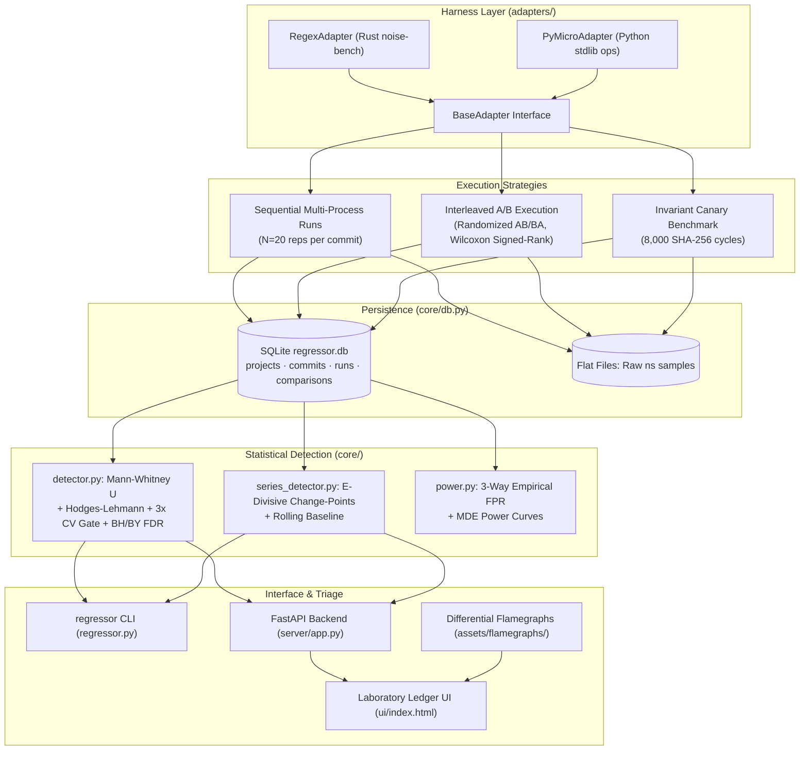

# Technical Reference: Architecture, Statistics & Methodology

Deep-dive reference for `regressor`: statistical derivations, subsystem design, empirical calibration, and historical study evaluation. For a 30-second quickstart, see [`README.md`](README.md); for Docker and bare-metal Linux CPU isolation, see [`SETUP.md`](SETUP.md); for raw Study 1/Study 2 forensics, see [`noise-bench/REPORT.md`](noise-bench/REPORT.md).

---

## Table of Contents

1. [Executive Overview](#1-executive-overview)
2. [The Real-World Engineering Problem](#2-the-real-world-engineering-problem)
3. [Prior Art & Ecosystem Comparison](#3-prior-art--ecosystem-comparison)
4. [System Architecture & Core Subsystems](#4-system-architecture--core-subsystems)
5. [Statistical Change-Point Detection Engine](#5-statistical-change-point-detection-engine)
6. [Advanced Detection Strategies](#6-advanced-detection-strategies)
7. [Hardware PMU Realities vs. Non-PMU Cloud VMs](#7-hardware-pmu-realities-vs-non-pmu-cloud-vms)
8. [Empirical Validation, Three-Way FPR & Power Curves](#8-empirical-validation-three-way-fpr--power-curves)
9. [Historical Benchmark Studies (`rust-lang/regex`)](#9-historical-benchmark-studies-rust-langregex)
10. [CLI & Web Dashboard Overview](#10-cli-and-web-dashboard-overview)
11. [Test Suite & Verification](#11-test-suite--verification)

---

## 1. Executive Overview

**`regressor`** is an open-source, project-agnostic continuous performance regression framework built to evaluate benchmark time series across git commits without drowning in cloud execution noise.

Shared CI infrastructure (virtual machines, multi-tenant cloud runners) exhibits **12% to 37%** timing variance across runs separated by hours due to CPU frequency scaling, hypervisor co-tenant contention, and host migrations. Naive fixed thresholds (e.g., "fail if $>5\%$ slower") trigger constant false alarms on noisy benchmarks while missing real regressions on stable ones.

`regressor` replaces fixed cutoffs with six coordinated layers:
1. **Distribution-free rank statistics**: Two-sided Mann-Whitney U test across independent per-run medians and Hodges-Lehmann effect-size estimation.
2. **Dynamic noise-floor gating**: Shifts must exceed $3\times$ the baseline benchmark's measured Coefficient of Variation (CV).
3. **Multi-testing error control**: Benjamini-Hochberg (BH) or Benjamini-Yekutieli (BY) False Discovery Rate control across batch comparisons.
4. **Interleaved A/B execution**: Randomized-order back-to-back paired runs tested with the Wilcoxon signed-rank test and Walsh Hodges-Lehmann bootstrap CIs.
5. **Series-level change-point scanning**: Energy-distance (E-Divisive) structural change-point detection and rolling-window baselines across commit timelines.
6. **Host-drift telemetry & triage**: Session-gap tagging, an invariant SHA-256 canary benchmark, and differential flamegraphs.

---

## 2. The Real-World Engineering Problem

### Why Naive Benchmarking Fails in Virtualized CI

- **Thermal and Frequency Variance**: CPU clock frequencies fluctuate dynamically based on package power budgets and cooling headroom.
- **Hypervisor Co-Tenancy**: Unrelated guests sharing physical sockets compete for L3 cache capacity and memory bandwidth.
- **Host Migrations & Idle Gaps**: Multi-hour gaps between runs frequently coincide with VM migrations or shifted host load. In Study 1, a **3h21m (201 min) wall-clock gap** between adjacent commits shifted three unrelated benchmarks simultaneously by **-12.85% to -25.73%**.

### The Five Methodological Traps

| Trap | Naive Practice | Consequence | `regressor` Solution |
|---|---|---|---|
| **1. Fixed Thresholds** | Flag any shift $>X\%$. | Quiet paths ($\text{CV}=1.3\%$) miss real regressions; noisy paths ($\text{CV}=10.5\%$) constantly false-alarm. | **Dynamic $3\times\text{CV}$ Gating**: Scales sensitivity directly to each benchmark's own baseline dispersion. |
| **2. Pooled Iteration Fallacy** | Pool $1{,}000+$ inner iterations from a single process into one two-sample test. | Inner iterations share ASLR layout, branch predictor history, and cache state—they are **not independent**, inflating $N$ and producing $p < 10^{-20}$ on noise. | **Process-Level Aggregation**: Summarize each independent process invocation to its median first; test strictly across independent run medians. |
| **3. Normality Assumption** | Use Student's $t$-test or mean $\pm$ std. | Latency distributions have heavy, asymmetric right tails from OS interrupts and page faults, distorting means and variances. | **Non-Parametric Ranking**: Mann-Whitney U / Wilcoxon signed-rank tests and Hodges-Lehmann shift estimators. |
| **4. Multi-Testing Explosion** | Run unadjusted $\alpha=0.05$ tests across 78 commit-benchmark pairs. | Chance of $\ge 1$ false alarm is $1 - (1 - 0.05)^{78} \approx 98.1\%$. | **BH / BY FDR Control**: Controls expected false discovery rate across the full batch at $Q = 0.05$. |
| **5. CPU Model String Check** | Compare `/proc/cpuinfo` strings to detect host changes. | Cloud hosts throttle clocks or migrate across identical CPU SKUs without changing the reported model string. | **Invariant Canary & Session Gaps**: Runs a deterministic SHA-256 workload (`ENVIRONMENT_SUSPECT`) and flags gaps $> 15$ min (`SESSION_BREAK`). |

---

## 3. Prior Art & Ecosystem Comparison

| Framework | Methodology & Strengths | Limitations Addressed by `regressor` |
|---|---|---|
| **benchstat (Go)** | Mann-Whitney U on per-run medians; Hodges-Lehmann delta; 95% CIs. Gold standard for pairwise comparisons. | Strictly pairwise; lacks batch-wide FDR control, series change-points, and host-drift canary telemetry. |
| **rustc-perf (Rust)** | Bare-metal Linux pinning (`isolcpus`); `perf stat` instruction counters (`PERF_COUNT_HW_INSTRUCTIONS`). | Requires dedicated bare-metal hardware with PMU access; not portable to unprivileged cloud CI runners. |
| **Hunter (MongoDB / DataStax)** | E-Divisive non-parametric change-point detection across full time series without pairwise dependence bugs. | Focused on macro time-series scanning; lacks a build/run adapter harness, interleaved A/B confirmation, or flamegraph UI. |
| **Mozilla Perfherder** | Dynamic noise bands and alert heuristics at large browser-CI scale. | Tightly coupled to Mozilla infrastructure; heuristic-heavy rather than unified rank statistics. |
| **asv (Python)** | Git commit series traversal, multi-benchmark tracking, and interactive web charts. | Relies primarily on flat percentage cutoffs; vulnerable to hypervisor timing jitter. |

`regressor` combines the pairwise rank statistics of `benchstat` with the series-level E-Divisive insight of `Hunter`, wrapped in a cross-language adapter layer, interleaved A/B confirmation, and synthetic validation gates.

---

## 4. System Architecture & Core Subsystems

### Component Blueprint



### The Adapter Abstraction Layer ([`adapters/base.py`](adapters/base.py))

`BaseAdapter` decouples the statistical engine from target language build systems:

```python
class BaseAdapter(ABC):
    @abstractmethod
    def list_benchmarks(self) -> List[str]: ...

    @abstractmethod
    def build(self, commit_ref: str, workdir: Optional[Path] = None) -> BuildResult: ...

    @abstractmethod
    def run(
        self,
        bench_name: str,
        iters: int,
        warmup: int,
        inject_ns: int = 0,
        artifact: Optional[str] = None,
    ) -> List[float]: ...
```

- **[`RegexAdapter`](adapters/regex_adapter.py)**: Compiles and runs the `noise-bench` Rust binary in isolated git worktrees (`workdir`), raising `FileNotFoundError` if the binary has not been built (never falls back silently).
- **[`PyMicroAdapter`](adapters/pymicro_adapter.py)**: Executes real Python stdlib workloads (`json_loads`, `sha256_small`) with real `busy_wait_ns` CPU work injection for cross-platform validation, tests, and `bisect --demo`.

### Persistence Layer & SQLite Schema ([`core/db.py`](core/db.py))

Raw per-iteration nanosecond timings stay in flat files referenced by path, while per-run medians, environment metadata, and comparisons are indexed in SQLite with uniqueness constraints (`uq_commits_project_sha`, `uq_runs_commit_bench_rep`) so imports are idempotent:

```sql
CREATE TABLE projects (
  id INTEGER PRIMARY KEY, name TEXT UNIQUE, repo_url TEXT,
  build_cmd TEXT, adapter TEXT, config_toml TEXT
);
CREATE TABLE commits (
  id INTEGER PRIMARY KEY, project_id INTEGER, sha TEXT, short_sha TEXT,
  author_date TEXT, subject TEXT, build_ok BOOLEAN, build_seconds REAL,
  cpu_model TEXT, rustc_version TEXT, run_started_utc TEXT, run_finished_utc TEXT
);
CREATE TABLE runs (
  id INTEGER PRIMARY KEY, commit_id INTEGER, benchmark TEXT, rep_index INTEGER,
  sample_file_path TEXT, median_ns REAL, pmu_json TEXT
);
CREATE TABLE comparisons (
  id INTEGER PRIMARY KEY, project_id INTEGER, base_commit_id INTEGER,
  cand_commit_id INTEGER, benchmark TEXT, p_value REAL, shift_pct REAL,
  noise_floor_pct REAL, verdict TEXT, fdr_significant BOOLEAN,
  resolution_note TEXT, resolution_status TEXT,
  canary_status TEXT DEFAULT 'OK', pmu_status TEXT DEFAULT 'UNAVAILABLE',
  session_gap_min REAL
);
```

---

## 5. Statistical Change-Point Detection Engine

### Why Student's t-Test Fails (OS Heavy-Tail Latency)

Software timing measurements violate normality and symmetry:
- Bounded on the left by minimum hardware execution time.
- Skewed by heavy right tails caused by interrupts, page faults, and scheduler preemptions.
- Arithmetic means $\bar{x}$ and sample variances $s^2$ are distorted by extreme tail outliers.

### Mann-Whitney U on Process Medians (Preventing the Pooling Bug)

[`core/detector.py`](core/detector.py) runs the two-sided **Mann-Whitney U rank-sum test** strictly on independent per-process medians ($N=20$ process invocations by default) rather than pooling inner iterations. Pooling $2{,}000$ inner iterations $\times 20$ runs into $N=40{,}000$ violates independence because inner iterations share ASLR layout, branch predictor state, allocator arenas, and L1/L2 cache lines—turning trivial jitter into $p < 10^{-20}$ false alarms.

### Hodges-Lehmann Estimator for Effect Size

Rather than subtracting means, `regressor` computes the **Hodges-Lehmann shift**—the median of all pairwise differences between candidate medians ($B$) and baseline medians ($A$):

$$\hat{\Delta}_{HL} = \operatorname{median}\left(\{b_j - a_i \mid a_i \in A, b_j \in B\}\right), \qquad \text{Shift \%} = \frac{\hat{\Delta}_{HL}}{\operatorname{median}(A)} \times 100\%$$

### Dynamic $3\times\text{CV}$ Noise-Floor Gating & Bessel's Correction ($\sqrt{20/19}$)

A shift is flagged only when it is statistically significant ($p < \alpha$) **and** exceeds the baseline noise floor:

$$\text{Noise Floor \%} = 3.0 \times \frac{s_{\text{baseline}}}{\bar{x}_{\text{baseline}}} \times 100\%$$

Sample standard deviation uses **Bessel's correction** (`ddof=1`, denominator $N-1$). Compared to legacy `ddof=0` scripts, noise floors at $N=20$ are $\sqrt{20/19} \approx 1.02598$ ($+2.60\%$) higher (for example, $0.93\%$ vs. $0.91\%$, and $5.18\%$ vs. $5.04\%$).

### Benjamini-Hochberg (BH) & Benjamini-Yekutieli (BY) FDR Control

Across $m$ comparisons, `bh_fdr_correct` sorts p-values $p_{(1)} \le \dots \le p_{(m)}$ and flags up to the largest rank $k$ satisfying:

$$p_{(k)} \le \frac{k}{m} \times Q \quad (Q = 0.05)$$

Because adjacent commit pairs share a commit ($C_i$ is candidate in $(C_{i-1}, C_i)$ and baseline in $(C_i, C_{i+1})$), consecutive shifts exhibit negative dependence outside standard BH guarantees. Passing `--fdr by` switches to **Benjamini-Yekutieli**, which divides $Q$ by $H(m) = \sum_{i=1}^{m} 1/i$ and remains valid under arbitrary dependence (BH remains the default to preserve exact Study 1 reproduction).

---

## 6. Advanced Detection Strategies

### Interleaved A/B Benchmarking & Paired Wilcoxon Signed-Rank Testing

[`core/interleaved.py`](core/interleaved.py) eliminates slow temporal drift at collection time by building `--base` and `--cand` in isolated worktrees and running them back-to-back in pairs ($A_k, B_k$):
- **Randomized pair order**: Each pair executes $A \to B$ or $B \to A$ with 50% probability so warmup bias cannot masquerade as a regression; `order_effect_pct` ($\operatorname{median}(d_{AB}) - \operatorname{median}(d_{BA})$) is reported as a diagnostic.
- **Paired test & CI**: Percentage differences $d_k = 100 \cdot (B_k - A_k)/A_k$ are tested via the two-sided **Wilcoxon signed-rank test**, paired with the one-sample **Walsh Hodges-Lehmann** estimate and a 2,000-resample 95% bootstrap CI.
- **Power guard & p-value floor**: Pair counts incapable of reaching $\alpha$ are rejected upfront (e.g., $N=7$ cannot reach $\alpha=0.01$). When every non-zero pair moves in the same direction, exact Wilcoxon p-values hit their floor $2/2^N$ ($1.86\times 10^{-9}$ for $N=30$) and are annotated `(floor)` so results are compared by shift and CI rather than p-value.
- **CI-bound gating (`--require-ci-bound`)**: Optionally requires the entire 95% CI bound (not just the point estimate) to clear `--min-effect`.

### Series-Level E-Divisive Change-Point Detection & Rolling Baselines

[`core/series_detector.py`](core/series_detector.py) provides two mechanisms that avoid adjacent-pair coupling:
- **E-Divisive (`changepoint`)**: Computes 1-D Energy Distance across all admissible splits $\tau$ in $O(n^2)$ time via a 2-D cumulative sum over $|x_i - x_j|$. Significance is evaluated by permuting the series and taking the **maximum statistic over all splits** $\max_\tau S_{\text{perm}}(\tau)$—which holds pure-noise FPR at **4.3%** vs. **37.3%** when permuting at only the observed split. Change points crossing session gaps $> 15$ min (`core/session.py`) are tagged `SESSION_BREAK`, and shifts are checked against commit-median standard error (`exceeds_noise_floor`). Because E-Divisive assumes exchangeability under the null, treat change points as triggers for `compare-interleaved` verification rather than standalone verdicts.
- **Rolling baseline (`batch --rolling-window K`)**: Compares each candidate commit against the pooled runs of the last $K$ commits so a single noisy commit does not trigger consecutive opposite-sign false alarms.

### Autocorrelation Diagnostics & Moving-Block Bootstrap

When runs within a commit exhibit serial correlation (thermal ramp or persistent co-tenant load), [`core/detector.py`](core/detector.py) records lag-1 autocorrelation (`lag1_autocorr`), AR(1) effective sample size (`effective_sample_size`), and Spearman run-order trend (`order_trend`). Passing `batch --adjust-autocorr` computes a moving-block bootstrap p-value alongside Mann-Whitney (`p_value = max(mw_p, block_p)`).

### Invariant Canary Benchmark ([`core/canary.py`](core/canary.py))

Before and after each `compare-interleaved` window, `CanaryBenchmark` samples an 8,000-iteration SHA-256 loop (`warmup=2` initial cold-start samples discarded). It flags `ENVIRONMENT_SUSPECT` when the canary median shifts by more than:

$$\max\left(\min\left(2 \times \text{CV}_{\text{MAD}},\ 5.0\%\right),\ 2.5\%\right)$$

Using $1.4826 \times \text{MAD}/\text{median}$ with a `5.0%` upper cap prevents a single cold-start outlier or noisy baseline from blinding the canary to real >5% host drift.

---

## 7. Hardware PMU Realities vs. Non-PMU Cloud VMs

Hardware Performance Monitoring Units (PMUs) count microarchitectural events such as retired instructions (`PERF_COUNT_HW_INSTRUCTIONS`), which remain invariant to CPU frequency throttling. However, standard cloud VMs and Windows hosts cannot expose `perf_event_open` MSRs (`<not supported>` or `EACCES`).

`regressor` records `pmu_status: "UNAVAILABLE"` whenever hardware counters cannot be read rather than fabricating estimates. On `0a446ec`, triage relied on software `cpu-clock` flamegraph sampling (`+0.3%` CPU sample delta); on `8f5d947`, local Windows verification combined wall-clock timings, user-space `_rdtsc` cycle counts, and compiled LTO x86_64 assembly instruction inspection. See [`SETUP.md`](SETUP.md) for bare-metal Linux PMU and `isolcpus` configuration.

---

## 8. Empirical Validation, Three-Way FPR & Power Curves

### 3-Point Synthetic Injection Gate

Before trusting any adapter on real commits, `regressor validate-adapter` enforces three checks using real busy-wait CPU cycles (`busy_wait_ns`) inside the timed loop:
1. **True Negative (`0 ns` injection)**: Same code vs. itself $\rightarrow$ `ok`.
2. **Large Injection (`~8%` of baseline median)**: Real slowdown $\rightarrow$ `flag`.
3. **Small Injection (`~1%` of baseline median)**: Passes if gated out by the $3\times\text{CV}$ floor (`ok`) **or** if the host's measured floor is already below the 1% injection (`noise_floor_pct < small_target_pct` and `|shift_pct| <= 3 * small_target_pct`), preventing clean low-noise hosts from failing the sanity check while catching broken or over-amplifying adapters.

### Three-Way Empirical False-Positive Rate & Power Curves ([`core/power.py`](core/power.py))

A single within-session A/A number hides where real false positives originate. Running `python regressor.py evaluate-power regex --benchmark compile_moderate` against the 50-run baseline session (`noise-bench/results/20260813T150528_baseline`) and Study 1 batch history measures three distinct FPR tiers ($\alpha = 0.01$, $3\times\text{CV}$ gate) plus empirical MDE curves (300 trials/point):

| FPR Measurement Tier | Observed Flags | FPR (95% Clopper-Pearson CI) |
|---|---|---|
| **1. Within-session A/A (random split)** — jitter only (`compile_moderate`, `find_iter_userid`, `is_match_status`) | 0 / 1,000 each | **0.00%** `[0.00%, 0.37%]` |
| **2. Within-session A/A (first half vs. second half)** — slow in-session drift | 0 / 3 benchmarks | **0.00%** (all `ok`) |
| **3. Historical doc-only null transitions (all)** | 4 / 21 comparisons | **19.05%** `[5.45%, 41.91%]` |
| ↳ *Within session ($\text{gap} \le 15$ min)* | 1 / 18 | **5.56%** `[0.14%, 27.29%]` |
| ↳ *Across session break ($\text{gap} > 15$ min)* | 3 / 3 | **100.00%** `[29.24%, 100.00%]` |

**Empirical Statistical Power (`compile_moderate`, 50-run session pool, 300 trials/point):**

| Reps ($N$) | $+1\%$ | $+2\%$ | $+3\%$ | $+5\%$ | $+8\%$ | $+10\%$ | $+15\%$ | MDE at 80% Power |
|---:|---:|---:|---:|---:|---:|---:|---:|---:|
| `N=5` | 0.03 | 0.10 | 0.28 | 0.76 | 0.99 | 1.00 | 1.00 | **+8%** |
| `N=10` | 0.00 | 0.05 | 0.21 | 0.72 | 1.00 | 1.00 | 1.00 | **+8%** |
| `N=15` | 0.00 | 0.03 | 0.17 | 0.81 | 1.00 | 1.00 | 1.00 | **+5%** |
| `N=20` | 0.00 | 0.00 | 0.11 | 0.86 | 1.00 | 1.00 | 1.00 | **+5%** |
| `N=25` | 0.00 | 0.00 | 0.05 | 0.89 | 1.00 | 1.00 | 1.00 | **+5%** |

Sub-3% shifts show near-zero detection power in sequential 20-rep mode because the $3\times\text{CV}$ gate intentionally filters shifts below the host noise floor; detecting 1%–3% effects requires either pinned hardware or paired `compare-interleaved` runs.

---

## 9. Historical Benchmark Studies (`rust-lang/regex`)

### Study 1: 27 Commits (14 Aug 2025 – 27 Jan 2026)

Evaluated across 27 commits from `rust-lang/regex` spanning **14 Aug 2025 to 27 Jan 2026**, picked from **62 commits** in that range touching `src/`, `regex-automata/src/`, or `regex-syntax/src/` (78 adjacent pairwise comparisons across `compile_moderate`, `find_iter_userid`, and `is_match_status`).

> **Scope Note**: Three single-threaded microbenchmarks evaluate only those three specific code paths (`Regex::new` construction, `find_iter` log matching, and `is_match` early-exit). They cannot rule out regressions in untested APIs or multi-threaded workloads.

Across 78 sequential comparisons, the detector raised **5 sequential flags**—all 5 triaged as false positives—and **1 sub-threshold candidate (`8f5d947`)** initially under investigation:

| Commit | Benchmark | Measured Shift | p-value | Noise Floor | Root Cause & Resolution |
|---|---|---:|---:|---:|---|
| `16d47c5` | `find_iter_userid` | **+1.45%** | $1.92 \times 10^{-7}$ | 0.93% | Doc-only change (`LazyLock` suggestion); background cache jitter. |
| `0a446ec` | `compile_moderate` | **+12.13%** | $7.90 \times 10^{-8}$ | 5.18% | Clippy lint cleanup. Did not reproduce under software `cpu-clock` profiling (`+0.3%`, [`assets/flamegraphs/flamegraph_diff.svg`](assets/flamegraphs/flamegraph_diff.svg)) or 30-pair `compare-interleaved` (`+0.36%`, $p=0.440$, `ok`). |
| `dd96592` | `compile_moderate` | **-21.37%** | $6.80 \times 10^{-8}$ | 2.25% | Doc-only CRLF clarification after a 201 min (3h21m) session gap; all 3 benchmarks shifted concurrently. |
| `dd96592` | `find_iter_userid` | **-25.73%** | $6.80 \times 10^{-8}$ | 2.58% | Concurrent host shift from 201 min session gap. |
| `dd96592` | `is_match_status` | **-12.85%** | $6.76 \times 10^{-8}$ | 0.76% | Concurrent host shift from 201 min session gap. |

In addition, `8f5d947` (`find_iter_userid`, $+2.95\%$ sequential below the $5.19\%$ `3x CV` floor, initially under investigation) was flagged by E-Divisive ($+2.53\%$, $p=0.020$) and measured $+4.10\%$ on 30-pair `compare-interleaved` ($\text{CI}_{95}[+3.68\%, +4.51\%]$, $p=1.86\times 10^{-9}$; $+4.31\%$ wall-clock and $+4.26\%$ `_rdtsc` cycles on local hardware). Full LTO assembly inspection and same-hash ablation (`8f5d947-ablation vs 8f5d947`: $+0.08\%$ wall-clock / $+0.06\%$ TSC cycles, $p=0.804$, `ok`; `977feeb vs 8f5d947-ablation`: $+3.27\%$ with $+0$ executed instructions) proved the shift is dominated by LTO binary-layout reordering from `8f5d947`'s doc-comment changes rather than the `+2` instructions/match of `captures_disabled()`.

### Study 2: Extending History (`4733e28..3d79fe9`, 27 Jan – 7 Nov 2026)

Extending the study across the **23 new source-touching commits** landed after `4733e28` (24 commits including the anchor, 69 comparisons across 3 benchmarks, 0 session breaks; stored in [`data/regex_study2_history.json.gz`](data/regex_study2_history.json.gz) and [`noise-bench/results/study2_analysis.json`](noise-bench/results/study2_analysis.json)) raised 4 sequential flags: 3 failed to reproduce under 30-pair `compare-interleaved` (`p = 0.280`, `0.477`, `0.584`) and 1 (`4733e28 -> c4865a0`, `+2.63%` interleaved on `find_iter_userid`) was a cross-crate LTO layout effect from a `regex-syntax` negated character-class fix unrelated to `user_id=(\d+)`. Result: **0 confirmed regressions** across both studies (`0/3` doc-only null transitions flagged in Study 2). See [`noise-bench/REPORT.md`](noise-bench/REPORT.md) for the full write-up.

---

## 10. CLI and Web Dashboard Overview

Key commands (see [`README.md`](README.md#cli-cheat-sheet) for the full quickstart sequence):

```bash
python regressor.py validate-adapter PyMicroAdapter --reps 20
python regressor.py compare-interleaved --adapter RegexAdapter --repo regex --base 16d47c5 --cand 0a446ec
python regressor.py evaluate-power regex --benchmark compile_moderate --trials 100
python regressor.py changepoint regex --benchmark compile_moderate
python regressor.py batch regex --fdr by
python regressor.py analyze regex 16d47c5 0a446ec
python regressor.py bisect --adapter RegexAdapter --repo regex --good cf00423 --bad 0a446ec --benchmark compile_moderate
python regressor.py serve --port 8000
```

### Laboratory-Ledger Web Dashboard (`http://localhost:8000`)

Served by [`server/app.py`](server/app.py) and [`ui/index.html`](ui/index.html) with strict CSP headers (vendored Chart.js, no third-party CDNs) and XSS-safe DOM rendering:
- **Time-Series Panels**: Median trend lines with p10–p90 envelopes and diamond markers for `SESSION_BREAK` transitions.
- **Commit Drill-Down Modal**: Displays per-run medians, 10-bin latency histograms, and session-gap context (`/api/commits/{sha}/distribution`).
- **Ad-Hoc Pairwise Comparison**: Evaluates Mann-Whitney U and Hodges-Lehmann shift between any two SHA prefixes (`/api/compare`).
- **Differential Flamegraph Viewer**: Inspects SVG flamegraphs served from `/flamegraphs/`.

---

## 11. Test Suite & Verification

Run the test suite, linter, and end-to-end verification script:

```bash
pytest -p no:cacheprovider
ruff check .
sh scripts/verify.sh
```

| Test Module | Coverage Focus |
|---|---|
| [`tests/test_stats.py`](tests/test_stats.py) | Mann-Whitney U, Hodges-Lehmann, Bessel correction ($\sqrt{20/19}$), BH-FDR, canary drift, energy distance |
| [`tests/test_stage1_stats.py`](tests/test_stage1_stats.py) | E-Divisive permutation FPR, sample parsing, canary MAD spread & 5% cap, run-order trend diagnostics |
| [`tests/test_stage2_data.py`](tests/test_stage2_data.py) | Idempotent DB imports, `dedupe()`, `/series` query count ($\le 8$ connections), SHA validation, Study 1 reproduction |
| [`tests/test_new_methods.py`](tests/test_new_methods.py) | Interleaved paired Wilcoxon & Walsh HL, power guards, bisection, 3-way FPR & power curve, adapter honesty |
| [`tests/test_review_fixes.py`](tests/test_review_fixes.py) | p-value floor reporting, Benjamini-Yekutieli FDR, confirmation-batch bisection, unique SHA prefixes, CLI bounds |
| [`tests/test_session_api.py`](tests/test_session_api.py) | `core.session` gap thresholds and session-break exposure through FastAPI endpoints |
| [`tests/test_validation_gate.py`](tests/test_validation_gate.py) | Quiet-host vs. noisy-host 3-point synthetic validation gate and amplification failure checks |
| [`tests/test_stage4_hardening_and_handoff.py`](tests/test_stage4_hardening_and_handoff.py) | Path-traversal/git-ref injection guards, AR(1) block bootstrap, `--require-ci-bound`, SVG XSS escaping, Rust/UI checks |
| [`tests/test_stage5_api_hardening.py`](tests/test_stage5_api_hardening.py) | API mass-assignment/CSP headers, import validation, packaging/Docker/docs invariants, CLI doc command execution |
