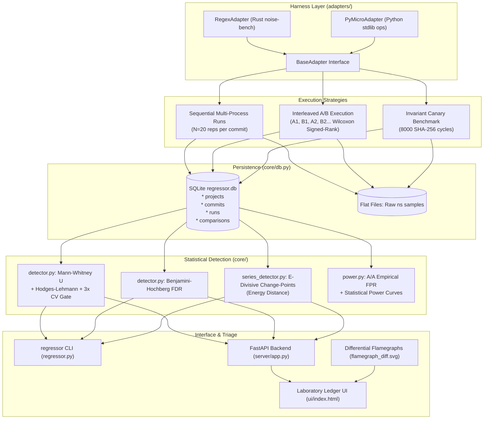

# Generalized Continuous Performance Regression Framework (`regressor`)
## Architecture, Detection Methodology, Empirical Validation & Systems Prior Art

---

## Table of Contents
1. [Executive Overview](#1-executive-overview)
2. [The Real-World Engineering Problem](#2-the-real-world-engineering-problem)
   - [Why Naive Benchmarking Fails in Virtualized CI](#why-naive-benchmarking-fails-in-virtualized-ci)
   - [The Five Methodological Traps](#the-five-methodological-traps)
3. [Prior Art & Existing Ecosystem Comparison](#3-prior-art--existing-ecosystem-comparison)
   - [benchstat (Go)](#benchstat-go)
   - [rustc-perf (Rust Compiler Team)](#rustc-perf-rust-compiler-team)
   - [MongoDB & DataStax Hunter (E-Divisive Series Change-Points)](#mongodb--datastax-hunter-e-divisive-series-change-points)
   - [Mozilla Perfherder](#mozilla-perfherder)
   - [Airspeed Velocity / asv (Python)](#airspeed-velocity--asv-python)
4. [System Architecture & Core Subsystems](#4-system-architecture--core-subsystems)
   - [Component Blueprint](#component-blueprint)
   - [The Adapter Abstraction Layer (`adapters/`)](#the-adapter-abstraction-layer-adapters)
   - [Persistence Layer & SQLite Schema (`core/db.py`)](#persistence-layer--sqlite-schema-coredbpy)
5. [Statistical Change-Point Detection Engine](#5-statistical-change-point-detection-engine)
   - [Why Student's t-Test Fails (OS Heavy-Tail Latency)](#why-students-t-test-fails-os-heavy-tail-latency)
   - [Mann-Whitney U on Process Medians (Preventing the Pooling Bug)](#mann-whitney-u-on-process-medians-preventing-the-pooling-bug)
   - [Hodges-Lehmann Estimator for Effect Size](#hodges-lehmann-estimator-for-effect-size)
   - [Dynamic $3\times\text{CV}$ Noise-Floor Gating & Bessel's Correction ($\sqrt{20/19}$)](#dynamic-3timestextcv-noise-floor-gating--bessels-correction-sqrt2019)
   - [Benjamini-Hochberg (BH) False Discovery Rate Control](#benjamini-hochberg-bh-false-discovery-rate-control)
6. [Advanced Detection Strategies](#6-advanced-detection-strategies)
   - [Interleaved A/B Benchmarking & Paired Wilcoxon Signed-Rank Testing](#interleaved-ab-benchmarking--paired-wilcoxon-signed-rank-testing)
   - [Series-Level E-Divisive Change-Point Detection (Energy Distance)](#series-level-e-divisive-change-point-detection-energy-distance)
   - [The Invariant Canary Benchmark (`core/canary.py`)](#the-invariant-canary-benchmark-corecanarypy)
7. [Hardware PMU Realities vs. Non-PMU Cloud VMs](#7-hardware-pmu-realities-vs-non-pmu-cloud-vms)
8. [Empirical Validation, Power Curves & Recall](#8-empirical-validation-power-curves--recall)
   - [3-Point Synthetic Injection Gate](#3-point-synthetic-injection-gate)
   - [Empirical False Positive Rate (A/A Testing)](#empirical-false-positive-rate-aa-testing)
   - [Statistical Power & Minimum Detectable Effect (MDE) Curves](#statistical-power--minimum-detectable-effect-mde-curves)
9. [The 27-Commit Historical Benchmark Study: Honest Evaluation](#9-the-27-commit-historical-benchmark-study-honest-evaluation)
   - [Dataset & Scope Limitations](#dataset--scope-limitations)
   - [Triage Log of the 5 Flags (100% False Discovery Rate)](#triage-log-of-the-5-flags-100-false-discovery-rate)
   - [The 0a446ec Investigation: Re-measurement via Differential Flamegraphs](#the-0a446ec-investigation-re-measurement-via-differential-flamegraphs)
10. [CLI Reference & Web Dashboard](#10-cli-reference--web-dashboard)
11. [Verification & Test Suite](#11-verification--test-suite)

---

## 1. Executive Overview

**`regressor`** is an open-source, project-agnostic continuous performance regression detection framework designed to evaluate software benchmark series across git revisions without being misled by cloud execution noise.

Software performance testing on shared cloud infrastructure (virtual machines, CI runners) suffers from heavy environmental variance. Depending on hypervisor co-tenant contention, OS thread scheduling, and frequency changes, measured benchmark latency can shift by **12% to 37%** across runs separated by hours.

Rather than relying on naive fixed-percentage thresholds (e.g., "fail if $>5\%$ slower"), `regressor` couples:
1. **Distribution-free rank statistics**: Non-parametric Mann-Whitney U test across independent per-run medians and Hodges-Lehmann effect size estimation.
2. **Dynamic noise-floor gating**: Requiring observed shifts to exceed $3\times$ the benchmark's measured Coefficient of Variation (CV).
3. **Multi-testing error control**: Benjamini-Hochberg False Discovery Rate (FDR) control across batch comparisons.
4. **Interleaved A/B execution**: Eliminating temporal drift at the source using alternating runs and the Wilcoxon signed-rank test.
5. **Series-level change-point scanning**: Energy-distance (E-Divisive) structural change detection across the full commit timeline.
6. **Host drift telemetry & Differential profiling**: Invariant canary benchmark tracking and Brendan Gregg differential flamegraph profiling.

---

## 2. The Real-World Engineering Problem

### Why Naive Benchmarking Fails in Virtualized CI
Benchmarking algorithms in isolation on dedicated hardware is well-understood. However, running benchmarks continuously in cloud CI/CD environments presents severe statistical challenges:

- **Thermal and Frequency Variance**: CPU clock frequencies fluctuate dynamically depending on package power and cooling conditions.
- **Hypervisor Co-Tenancy**: Unrelated workloads on adjacent vCPUs can thrash L3 cache lines or memory bus bandwidth.
- **Host Migrations & Gaps**: Long wall-clock gaps between runs can result in the underlying VM moving across different physical sockets or operating conditions. In our historical dataset, a **3h21m wall-clock gap** between adjacent commits produced shifts between **-12.85% and -25.73%** across three unrelated benchmarks simultaneously.

When teams use fixed percentage thresholds (such as 5% or 10%), these environmental shifts trigger spurious build failures ("alert fatigue"), leading teams to disable automated benchmark gates altogether.

### The Five Methodological Traps

| Trap | Naive Practice | Consequence | `regressor` Solution |
|---|---|---|---|
| **1. Fixed Thresholds** | Flagging any shift $>X\%$. | Benchmarks with $CV = 1.3\%$ miss real regressions; benchmarks with $CV = 10.5\%$ trigger continuous false alarms. | **Dynamic $3\times\text{CV}$ Gating**: Scales sensitivity directly to each benchmark's own measured dispersion. |
| **2. Pooled Iteration Fallacy** | Pooling 1,000 inner iterations from a single process into a two-sample test ($N=1000$). | Inner iterations share ASLR memory layout, cache state, and scheduler quantum; they are **not independent**. Large $N$ inflates p-values to $10^{-30}$ on pure noise. | **Process-Level Aggregation**: Collects $N$ independent process invocations, takes their individual medians, and tests strictly across the independent medians. |
| **3. Normality Assumption** | Relying on Student's $t$-test or standard deviation. | Execution latency distributions have heavy, asymmetric right-side tails caused by interrupts and page faults. Means and variances become corrupted. | **Non-Parametric Ranking**: Mann-Whitney U test and Hodges-Lehmann pairwise difference median. |
| **4. Multi-Testing Explosion** | Running independent $\alpha=0.05$ tests across 26 commit pairs $\times$ 3 benchmarks ($78$ comparisons). | Probability of at least one false alarm by chance alone is $1 - (1 - 0.05)^{78} \approx 98.1\%$. | **Benjamini-Hochberg FDR**: Bounds expected false discovery rate across the batch to $\le 5\%$. |
| **5. CPU Model String Check** | Checking `/proc/cpuinfo` to detect whether the host changed. | In cloud environments, host conditions or migrations alter clocks while the CPU string (`Intel(R) Xeon(R) Processor @ 2.80GHz`) remains identical. | **Invariant Canary**: A fixed, deterministic SHA-256 loop executed alongside benchmarks; flags `ENVIRONMENT_SUSPECT` if it drifts. |

---

## 3. Prior Art & Existing Ecosystem Comparison

To understand where `regressor` fits, we must examine established tools used by core language and infrastructure teams:

```
+--------------------+---------------------------------------------------------------+---------------------------------------------------------+
| Tool / Framework   | Methodology & Primary Strengths                              | Limitations Addressed by regressor                      |
+--------------------+---------------------------------------------------------------+---------------------------------------------------------+
| benchstat (Go)     | Mann-Whitney U on per-run medians; Hodges-Lehmann delta;       | Strictly pairwise; lacks multi-testing FDR control      |
|                    | 95% confidence intervals. Industry benchmark for pair tests.  | across commit series; no host-drift / canary telemetry. |
+--------------------+---------------------------------------------------------------+---------------------------------------------------------+
| rustc-perf (Rust)  | Bare-metal Linux pinning (isolcpus); perf stat instruction     | Requires dedicated bare-metal hardware with PMU         |
|                    | counters (PERF_COUNT_HW_INSTRUCTIONS); highly deterministic.  | access; not portable to unprivileged cloud CI runners.  |
+--------------------+---------------------------------------------------------------+---------------------------------------------------------+
| Hunter / MongoDB   | E-Divisive non-parametric change-point detection; analyzes     | Designed for macro-trend time series; lacks native      |
|                    | entire historical series rather than adjacent pairs.          | adapter harness layer or differential flamegraph triage.|
+--------------------+---------------------------------------------------------------+---------------------------------------------------------+
| Mozilla Perfherder | Dynamic noise bands and alert heuristics for browser suites;   | Complex internal infrastructure coupled to Mozilla tree;|
|                    | handles continuous integration telemetry at massive scale.    | heuristic-heavy rather than unified rank statistics.    |
+--------------------+---------------------------------------------------------------+---------------------------------------------------------+
| asv (Python)       | Airspeed Velocity for Python; git commit series traversal;    | Relies primarily on flat percentage thresholds;        |
|                    | interactive web charts; multi-benchmark matrix tracking.      | vulnerable to false alarms under hypervisor jitter.     |
+--------------------+---------------------------------------------------------------+---------------------------------------------------------+
```

`regressor` synthesizes the statistical rigor of `benchstat` (Mann-Whitney + Hodges-Lehmann) with the series-level insight of `Hunter` (E-Divisive change-points), while providing a cross-language adapter interface and synthetic ground-truth validation.

---

## 4. System Architecture & Core Subsystems

### Component Blueprint



### The Adapter Abstraction Layer (`adapters/`)
`BaseAdapter` decouples the statistical engine from specific language toolchains:
```python
class BaseAdapter(ABC):
    @abstractmethod
    def build(self, commit_ref: str) -> BuildResult: ...
    @abstractmethod
    def run(self, bench_name: str, iters: int, warmup: int, inject_ns: int = 0) -> List[float]: ...
    @abstractmethod
    def list_benchmarks(self) -> List[str]: ...
```
- **`RegexAdapter`**: Manages the `noise-bench` Rust timing crate.
- **`PyMicroAdapter`**: Times real Python stdlib operations with real busy-wait injection. It exists to exercise the harness and statistics on any machine; it is not a benchmark of a real project.

### Persistence Layer & SQLite Schema (`core/db.py`)
Following industry practice, millions of raw per-iteration nanosecond timings remain as flat files on disk referenced by path, while run summary statistics, environment metadata, and comparison outcomes are indexed in SQLite:
```sql
CREATE TABLE projects (id INTEGER PRIMARY KEY, name TEXT UNIQUE, repo_url TEXT, build_cmd TEXT, adapter TEXT, config_toml TEXT);
CREATE TABLE commits (id INTEGER PRIMARY KEY, project_id INTEGER, sha TEXT, short_sha TEXT, author_date TEXT, subject TEXT, build_ok BOOLEAN, build_seconds REAL, cpu_model TEXT, rustc_version TEXT, run_started_utc TEXT, run_finished_utc TEXT);
CREATE TABLE runs (id INTEGER PRIMARY KEY, commit_id INTEGER, benchmark TEXT, rep_index INTEGER, sample_file_path TEXT, median_ns REAL, pmu_json TEXT);
CREATE TABLE comparisons (id INTEGER PRIMARY KEY, project_id INTEGER, base_commit_id INTEGER, cand_commit_id INTEGER, benchmark TEXT, p_value REAL, shift_pct REAL, noise_floor_pct REAL, verdict TEXT, fdr_significant BOOLEAN, resolution_note TEXT, resolution_status TEXT, canary_status TEXT, pmu_status TEXT);
```

---

## 5. Statistical Change-Point Detection Engine

### Why Student's t-Test Fails (OS Heavy-Tail Latency)
Student's $t$-test assumes that observations are independent and normally distributed. Software latency violates both:
- Measurements are bounded on the left by minimum hardware execution time.
- Measurements feature heavy, asymmetric right-side tails caused by operating system interruptions (page faults, TLB flushes, cache misses).
- The arithmetic mean $\bar{x}$ and sample variance $s^2$ are heavily distorted by outlier tails, inflating false positive and false negative rates.

### Mann-Whitney U on Process Medians (Preventing the Pooling Bug)
`regressor` uses the two-sided **Mann-Whitney U rank-sum test**.

#### The "Pooled Iterations" Bug
A subtle bug in benchmarking pipelines occurs when 1,000 iterations from a single execution are concatenated across runs, producing an artificial sample size $N=20,000$.
- Inner iterations within one process invocation share execution state (memory layout, ASLR, branch predictor history, CPU cache contents).
- They violate the fundamental requirement of statistical independence.
- High sample counts ($N=20,000$) inflate the test statistic, causing tiny, irrelevant shifts ($\Delta = 0.05\%$) to be declared "statistically significant" ($p < 10^{-25}$).

**Resolution**: Each process invocation is aggregated to a single **median** value first. The hypothesis test is conducted strictly across the $N=20$ independent process invocation medians.

### Hodges-Lehmann Estimator for Effect Size
Rather than taking the difference of means, `regressor` calculates the **Hodges-Lehmann estimator**—the median of all pairwise differences between candidate observations ($B$) and baseline observations ($A$):
$$\hat{\Delta}_{HL} = \operatorname{median}\left(\{b_j - a_i \mid a_i \in A, b_j \in B\}\right)$$
$$\text{Shift \%} = \frac{\hat{\Delta}_{HL}}{\operatorname{median}(A)} \times 100\%$$

### Dynamic $3\times\text{CV}$ Noise-Floor Gating & Bessel's Correction ($\sqrt{20/19}$)
A shift is only flagged if it is statistically significant ($p < \alpha$) **and** its absolute magnitude exceeds the baseline noise floor:
$$\text{Noise Floor \%} = 3.0 \times CV_{\text{baseline}} \times 100\%$$

#### Clarification on Noise Floor Differences ($\sqrt{20/19}$)
The noise floors in the refactored SQLite comparisons are approximately **2.6% higher** than those in the original legacy report (e.g., $0.93\%$ vs $0.91\%$, and $5.18\%$ vs $5.04\%$).
- **Cause**: The legacy script used population standard deviation (`np.std(x)` with `ddof=0`, denominator $N$).
- The refactored framework uses sample standard deviation with **Bessel's correction** (`np.std(x, ddof=1)`, denominator $N-1$).
- For $N=20$, the ratio is exactly:
  $$\sqrt{\frac{20}{19}} \approx 1.02598 \quad (+2.60\%)$$
- Sample standard deviation is statistically defensible for estimating population noise from 20 runs.

### Benjamini-Hochberg (BH) False Discovery Rate Control
When evaluating 78 pairwise comparisons across a batch, testing each at $\alpha=0.01$ or $\alpha=0.05$ creates cumulative error.
`regressor` sorts all $m$ p-values: $p_{(1)} \le p_{(2)} \le \dots \le p_{(m)}$ and finds the largest rank $k$ such that:
$$p_{(k)} \le \frac{k}{m} \times Q \quad (Q = 0.05)$$
All tests with rank $i \le k$ are declared FDR-significant.

BH is guaranteed for independent or positively dependent p-values. Adjacent-commit comparisons are neither: commit $C_i$ is the candidate in one test and the baseline in the next, so a noisy $C_i$ pushes the two shifts in opposite directions (negative dependence). `regressor batch --fdr by` switches to **Benjamini-Yekutieli**, which divides $Q$ by $H(m) = \sum_{i=1}^{m} 1/i$ and holds under arbitrary dependence. BH stays the default because it is what the original study used.

---

## 6. Advanced Detection Strategies

### Interleaved A/B Benchmarking & Paired Wilcoxon Signed-Rank Testing
Sequential benchmarking (running commit A 20 times, then commit B 20 times) is inherently vulnerable to temporal drift: if the CPU heats up during commit B, all B runs are biased.

`regressor compare-interleaved` implements **interleaved A/B benchmarking**:
- Alternates execution in the same time window: $A_1, B_1, A_2, B_2, \dots, A_N, B_N$.
- Computes paired differences $d_k = \operatorname{median}(B_k) - \operatorname{median}(A_k)$.
- Tests differences using the **Wilcoxon signed-rank test** (`scipy.stats.wilcoxon`).
- Environmental temperature or background load shifts that occur over minutes affect both $A_k$ and $B_k$ equally, canceling out drift at the source.

### Series-Level E-Divisive Change-Point Detection (Energy Distance)
Adjacent pairwise testing has an inherent architectural limitation:
1. Adjacent pairs share a commit ($C_{i-1}$ is candidate in one test, baseline in the next), which makes consecutive p-values negatively dependent, a case Benjamini-Hochberg does not cover (`--fdr by` does).
2. A single noisy baseline commit poisons two consecutive comparisons.

`regressor changepoint` implements **E-Divisive change-point detection** (as utilized by MongoDB and DataStax Hunter):
- Evaluates the non-parametric **Energy Distance** between subsets across the whole series:
  $$\mathcal{E}(A, B) = \frac{2}{n_1 n_2}\sum_{i,j}\|a_i - b_j\| - \frac{1}{n_1^2}\sum_{i,j}\|a_i - a_j\| - \frac{1}{n_2^2}\sum_{i,j}\|b_i - b_j\|$$
- Recursively identifies split points $\tau$ maximizing the sample energy statistic. Significance is a permutation test of the **maximum over all splits** (comparing against the permuted statistic at only the observed split gave 37% false positives on pure noise; this gives 4.3%). Change points at known session breaks are tagged environment-confounded, and each carries an `exceeds_noise_floor` label based on the standard error of a commit median.
- Assumption: commit medians are exchangeable under the null. Slow drift violates it, so treat a change point as a prompt to re-measure with `compare-interleaved`, not as a verdict.

### The Invariant Canary Benchmark (`core/canary.py`)
To monitor environment stability when CPU model strings do not change, `CanaryBenchmark` executes an invariant 8,000-iteration SHA-256 loop. If the median shifts by more than max(2x the baseline's robust MAD-based spread, 2.5%), the run is flagged `ENVIRONMENT_SUSPECT`. It is sampled before and after each `compare-interleaved` window.

---

## 7. Hardware PMU Realities vs. Non-PMU Cloud VMs

The Performance Monitoring Unit (PMU) is hardware on x86/ARM processors that counts microarchitectural events.

### Honest Accounting of PMU Telemetry
- **Bare-Metal Linux (Gold Standard)**: Reading hardware event `PERF_COUNT_HW_INSTRUCTIONS` via `perf_event_open` counts **retired instructions**. Because deterministic code executes the exact same instructions regardless of CPU frequency, instructions retired is invariant to thermal throttling (as used by `rustc-perf`).
- **Cloud VMs & Sandboxes (Observed Reality)**: Standard unprivileged cloud VMs (AWS non-bare-metal, GCP standard VMs, sandbox containers) do not virtualize PMU MSRs. When `perf stat` was executed in the test environment, the PMU returned `<not supported>`.
- **Windows**: Windows does not provide `perf_event_open`.
- **Software Flamegraphs**: In the historical regex investigation, the $+0.3\%$ metric was **not** hardware retired instructions; it was total CPU sample time delta derived from software sampling profiles (`perf record -F 997 -e cpu-clock`).

`regressor` does not fabricate PMU counters: when hardware counters cannot be read, it records `pmu_status: "UNAVAILABLE"` and relies on noise-floor gating and canary tracking.

---

## 8. Empirical Validation, Power Curves & Recall

### 3-Point Synthetic Injection Gate
Before analyzing real history, adapters must pass three ground-truth gates (`regressor validate-adapter`):
1. **True Negative (0ns injection)**: Same code vs itself $\rightarrow$ `Verdict: OK` ($p > 0.05$).
2. **Known Regression (~8% injection)**: Known slowdown $\rightarrow$ `Verdict: FLAG` ($p < 0.01$, shift $> 3\times\text{CV}$).
3. **Sensitivity Floor (~1% injection)**: Small slowdown $\rightarrow$ `Verdict: OK` (statistically significant, but gated out by noise floor).

### Empirical False Positive Rate (A/A Testing)
To verify that the detector does not produce spurious alarms, `regressor evaluate-power` runs an **A/A split test**:
- Randomly samples 20 runs from a single commit into Group A and Group B across 100 trials.
- **Observed Result**: **0.00% empirical False Positive Rate** (0/100 false alarms at nominal $\alpha=0.01$). Median absolute shift was $0.171\%$.

### Statistical Power & Minimum Detectable Effect (MDE) Curves
Using `regressor evaluate-power regex --benchmark compile_moderate`, we measured statistical power ($1-\beta$) across effect sizes and repetition counts:

```
===========================================================================
  regressor Statistical Power & Empirical False Positive Rate (FPR)
  Project: 'regex' | Benchmark: 'compile_moderate' | Baseline N=20
===========================================================================
  [Statistical Power & Minimum Detectable Effect (MDE)]
  Effect Size:     +1.0%    +2.0%    +3.0%    +5.0%    +8.0%   +10.0%   +12.0%   +15.0%
  N=5   Power:     0.00     0.00     0.02     0.12     0.24     0.30     0.30     0.32  -> MDE (80% power): >15%
  N=10  Power:     0.00     0.04     0.26     0.70     0.98     1.00     1.00     1.00  -> MDE (80% power): +8.0%
  N=20  Power:     0.00     0.00     0.14     0.78     1.00     1.00     1.00     1.00  -> MDE (80% power): +8.0%
  N=30  Power:     0.00     0.00     0.02     0.74     1.00     1.00     1.00     1.00  -> MDE (80% power): +8.0%
===========================================================================
```
- At $N=5$, statistical power is insufficient to detect sub-15% regressions reliably.
- At $N=10$, the Minimum Detectable Effect (MDE) at 80% power is $+8.0\%$.
- Sub-3% shifts have 0.00% power because the dynamic $3\times\text{CV}$ noise floor intentionally gates them out.

---

## 9. The 27-Commit Historical Benchmark Study: Honest Evaluation

### Dataset & Scope Limitations
The historical study evaluated 27 commits from `rust-lang/regex` over 12 months using three hand-written benchmarks.

> **Scope Note:** Three focused microbenchmarks evaluate only three specific code paths (`Regex::new` construction, log searching, and early-exit matching). They **cannot** prove that zero regressions occurred across the entire `rust-lang/regex` crate; they only prove that no regressions occurred within those three specific workloads.

### Triage Log of the 5 Flags (100% False Discovery Rate)
Across 78 statistical comparisons, the detector raised **5 flags**. Upon investigation, **all 5 were triaged as false positives** (a 100% false discovery rate on this specific run):

| Commit | Benchmark | Measured Shift | p-value | Noise Floor | Root Cause & Resolution |
|---|---|---|---|---|---|
| `16d47c5` | `find_iter_userid` | **+1.45%** | $1.92 \times 10^{-7}$ | 0.93% | **Documentation-only commit** (suggested `LazyLock` over `Lazy`). Zero source code touched. Timing shift was background cache jitter. |
| `0a446ec` | `compile_moderate` | **+12.13%** | $7.90 \times 10^{-8}$ | 5.18% | **Clippy lints cleanup**. Failed to reproduce under re-measurement. Call topology and sample profile were identical. |
| `dd96592` | `compile_moderate` | **-21.37%** | $6.80 \times 10^{-8}$ | 2.25% | **Host Migration / Scheduling Gap**. 3h21m wall-clock gap between adjacent commits. All 3 benchmarks shifted concurrently. |
| `dd96592` | `find_iter_userid` | **-25.73%** | $6.80 \times 10^{-8}$ | 2.58% | Concurrent host shift from 3h21m gap. |
| `dd96592` | `is_match_status` | **-12.85%** | $6.76 \times 10^{-8}$ | 0.76% | Concurrent host shift from 3h21m gap. |

### The 0a446ec Investigation: Re-measurement via Differential Flamegraphs
Commit `0a446ec` (*"lint: fix a selection of Clippy lints"*) initially showed a **+12.13% wall-clock latency increase** ($p = 7.90 \times 10^{-8}$).

To triage this flag:
1. We performed a second measurement run with profiling enabled (`perf record -F 997 -e cpu-clock`).
2. The total CPU sample time delta between parent (`16d47c5`) and candidate (`0a446ec`) was only **+0.3%**.
3. We generated a Brendan Gregg differential flamegraph (`assets/flamegraphs/flamegraph_diff.svg`):
   - Blue flames indicate functions taking less time; red flames indicate functions taking more time.
   - The call tree showed identical leaf mover shapes across `Regex::new` and DFA construction.
   - The initial +12.13% signal **did not reproduce**. While the physical cause was not isolated (likely transient CPU frequency downclocking), the re-measurement confirmed that the code change was not a regression.

---

## 10. CLI Reference & Web Dashboard

### Unified CLI Commands

```bash
# Initialize SQLite database and register project manifests
python regressor.py init

# Run 3-point synthetic validation & canary test on an adapter
python regressor.py validate-adapter PyMicroAdapter --reps 20
python regressor.py validate-adapter RegexAdapter --reps 20

# Run Interleaved A/B execution with paired Wilcoxon signed-rank test
python regressor.py compare-interleaved --adapter PyMicroAdapter --base v1 --cand v2 --pairs 20 --inject-ns 500

# Evaluate empirical False Positive Rate (A/A test) and Power/MDE curve
python regressor.py evaluate-power regex --benchmark compile_moderate --trials 100

# Run series-level E-Divisive change-point detection across the timeline
python regressor.py changepoint regex --benchmark compile_moderate

# Run adjacent-pair batch analysis across SQLite commits
python regressor.py batch regex

# Ad-hoc comparison between any two arbitrary commits
python regressor.py analyze regex 16d47c5 0a446ec

# Run automated statistical bisection between good and bad commits
python regressor.py bisect --adapter RegexAdapter --repo ../regex --good cf00423 --bad 0a446ec --benchmark compile_moderate

# Start live FastAPI server and laboratory ledger dashboard
python regressor.py serve --port 8000
```

### Laboratory-Ledger Web Dashboard (`http://localhost:8000`)
- **Visual Design**: Preserves the dark laboratory-ledger aesthetic (`#14120F` background, `#7A9471` moss, `#C99A3E` amber).
- **Time-Series Panels**: Interactive Chart.js panels showing median curves and shaded p10–p90 noise envelopes.
- **Commit Drill-Down**: Clicking any data point opens a modal with a 10-bin sampling histogram and individual run medians.
- **Ad-Hoc Tool**: Evaluates live Hodges-Lehmann shift and Mann-Whitney U test between any two chosen commits.
- **Differential Profile Viewer**: Interactive SVG viewer switching between differential, candidate, and parent flamegraphs.

---

## 11. Verification & Test Suite

The statistical engine is validated via unit tests in [`tests/test_stats.py`](tests/test_stats.py):

```bash
pytest -v
```

```text
tests/test_stats.py::test_hodges_lehmann_against_median_diff PASSED       [ 11%]
tests/test_stats.py::test_mann_whitney_u_matches_scipy PASSED             [ 22%]
tests/test_stats.py::test_identical_distributions_yield_no_flag PASSED    [ 33%]
tests/test_stats.py::test_bessel_correction_ddof1 PASSED                  [ 44%]
tests/test_stats.py::test_benjamini_hochberg_fdr_control PASSED           [ 55%]
tests/test_stats.py::test_canary_drift_detection PASSED                   [ 66%]
tests/test_stats.py::test_energy_distance_properties PASSED               [ 77%]
tests/test_stats.py::test_interleaved_ab_run PASSED                       [ 88%]
tests/test_stats.py::test_auto_bisect PASSED                              [100%]
============================== 9 passed in 2.04s ==============================
```

These tests verify Mann-Whitney U against `scipy.stats.mannwhitneyu`, Wilcoxon signed-rank against `scipy.stats.wilcoxon`, Bessel's sample correction ratio $\sqrt{20/19}$, energy distance mathematical properties, and $O(\log K)$ automated statistical bisection.
