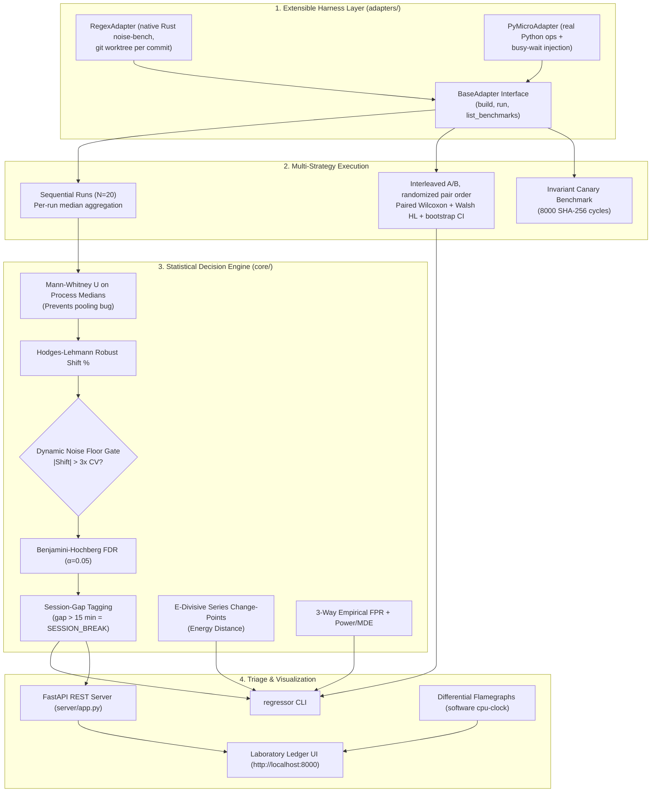

# regressor: Generalized Continuous Performance Regression Framework

[](https://github.com/SeeThisDiva/regressor/actions/workflows/tests.yml)
[](https://en.wikipedia.org/wiki/Mann%E2%80%93Whitney_U_test)
[](adapters/)
[](LICENSE)

> **A project-agnostic, statistically rigorous framework for continuous performance regression detection in cloud CI/CD.**  
> Combines non-parametric rank statistics, dynamic $3\times\text{CV}$ noise-floor gating, Benjamini-Hochberg FDR control, interleaved A/B execution, invariant canary tracking, and series-level E-Divisive change-point detection.

---

## The Core Problem

Running automated performance benchmarks in virtualized cloud environments (AWS, GCP, GitHub Actions) is plagued by **12% to 37% timing variance** on identical, unchanged code due to:
* Dynamic CPU frequency scaling and thermal throttling.
* Hypervisor co-tenant vCPU contention on shared hardware.
* Uncontrolled cloud host migrations across multi-hour intervals.

Traditional benchmark systems rely on naive fixed percentage thresholds (e.g., `flag if >5% slower`). In shared cloud environments, this triggers **constant false alarms**, causing developer friction and alert fatigue.

---

## Architecture & Key Innovations



### 1. Interleaved A/B Benchmarking (`regressor compare-interleaved`)
Sequential benchmarking (running A 20x, then B 20x) is vulnerable to temporal thermal and scheduling drift. `compare-interleaved` builds two refs (`--base`, `--cand`) and runs them in pairs inside the same time window:
* **Randomized pair order**: each pair runs $A \to B$ or $B \to A$ with 50% probability, so second-run warmup bias cannot masquerade as a shift. The `order_effect_pct` diagnostic ($\text{median}(d_{AB}) - \text{median}(d_{BA})$) is reported so you can see whether order matters.
* **Paired test**: percentage differences $d_k = 100 \cdot (B_k - A_k)/A_k$ are tested with the **Wilcoxon signed-rank test**.
* **Effect size**: one-sample **Walsh Hodges-Lehmann** shift with a 2,000-resample 95% bootstrap CI.
* **Power guard**: pair counts that mathematically cannot reach $\alpha$ are refused (e.g. $N=7$ cannot reach $\alpha=0.01$).
* **p-value floor**: with $N$ non-zero pairs the exact test cannot go below $2/2^N$ ($1.86\times10^{-9}$ for 30 pairs). A result at that floor means every pair moved the same way; it is marked `(floor)` in the CLI and PR report, and such results should be compared by shift and CI, not by p.
* **Canary and CI exit code**: `--fail-on-regression` fails on a flagged slowdown even when the canary reports `ENVIRONMENT_SUSPECT` (the flag is attributed to drift in the report). Add `--no-fail-on-env-suspect` to keep the job green in that case.

### 2. Session-Break Tagging (`regressor batch`)
Every adjacent comparison records `session_gap_min`, the wall-clock minutes between the end of the base run and the start of the candidate run. Gaps over 15 minutes are tagged as crossing a measurement session, so host drift isn't silently reported as a code change:
```text
[FLAG] compile_moderate   a66fde6 -> dd96592   Shift: -21.37%   p=6.80e-08   floor=2.25%
       [SESSION_BREAK: 201 min gap before run — environment-confounded]
```
The dashboard shows the same information: session-break points render as diamonds on the timeline, the tooltip shows the gap before each run, and the commit drill-down shows the run window plus a warning banner.

### 3. Series-Level E-Divisive Change-Points (`regressor changepoint`)
Adjacent pairwise comparisons share a commit: $C_i$ is the candidate in one test and the baseline in the next, so a noisy $C_i$ pushes the two shifts in opposite directions. That negative dependence is outside what Benjamini-Hochberg guarantees (`batch --fdr by` switches to Benjamini-Yekutieli, valid under arbitrary dependence; BH stays the default to reproduce the original study). `regressor` also implements non-parametric **E-Divisive change-point detection** (Energy Distance) to identify macro structural shifts across the entire commit timeline simultaneously.

### 4. Process-Level Independence (Preventing the Pooling Fallacy)
Aggregates inner iterations to one summary **median per process invocation** first, running hypothesis tests strictly across independent process medians. This prevents non-independent cache/ASLR state from inflating test statistics into false significance ($p < 10^{-20}$).

### 5. Dynamic Noise-Floor Gating & Bessel's Correction
Shift must exceed $3\times\text{CV}$ of the baseline benchmark. Standard deviations use sample standard deviation (`ddof=1`, Bessel's correction), scaling the noise floor appropriately ($\sqrt{20/19}$ ratio over population std).

### 6. False-Positive Rate, Measured Three Ways (`regressor evaluate-power`)
A single A/A number hides where false alarms come from. `evaluate-power` reports three FPRs from real recorded runs, each with an exact Clopper-Pearson 95% CI:
1. **Within-session, random split**: run-to-run jitter only.
2. **Within-session, first half vs second half**: adds slow in-session drift.
3. **Historical doc-only null transitions**: real adjacent commits where the candidate changed no code, split by whether the comparison crossed a session break.

It also computes power curves and the Minimum Detectable Effect at 80% power by resampling real baseline runs.

### 7. Invariant Canary Benchmark (`core/canary.py`)
A fixed SHA-256 loop is sampled before and after every `compare-interleaved` window (`--canary-reps`, default 10, first 2 samples discarded as warmup). If the median moves by more than $\max(\min(2\times\text{CV}_{\text{MAD}}, 5.0\%), 2.5\%)$, the result is marked `ENVIRONMENT_SUSPECT` and any flag in that window is attributed `ENVIRONMENT_DRIFT_SUSPECTED`. The spread is MAD-based (a std-based CV let a single cold-start sample widen the band to about +/-27% and hid a 22% drift), and the `5.0%` upper cap (`max_allowed_noise_pct=5.0`) ensures a noisy baseline never blinds the canary to a $>5\%$ environment shift. The canary runs in the Python process, so it detects host-level change, not drift that only affects the benchmark binary.

### 8. Honest Adapters (`adapters/`)
* **`RegexAdapter`** runs the native `noise-bench` Rust binary, building each commit in an isolated git worktree. There is no silent fallback: if the binary is missing it raises `FileNotFoundError`.
* **`PyMicroAdapter`** runs real Python operations (`json_loads`, `sha256_small`) and injects slowdowns as real busy-wait CPU work. It is used for cross-platform validation, tests, and `bisect --demo`. It generates no synthetic noise.

> [!NOTE]
> Hardware PMU counters are not read. Unprivileged cloud VMs report `<not supported>` and Windows has no `perf_event_open`, so `pmu_status` is recorded as `UNAVAILABLE`.

---

## Prior Art & Ecosystem Comparison

```
+--------------------+---------------------------------------------------------------+---------------------------------------------------------+
| Framework          | Methodology & Primary Strengths                              | Limitations Addressed by regressor                      |
+--------------------+---------------------------------------------------------------+---------------------------------------------------------+
| benchstat (Go)     | Mann-Whitney U on per-run medians; Hodges-Lehmann delta;       | Strictly pairwise; lacks batch-wide FDR control and     |
|                    | 95% confidence intervals. Gold standard for pair comparisons. | host-drift canary telemetry.                            |
+--------------------+---------------------------------------------------------------+---------------------------------------------------------+
| rustc-perf (Rust)  | Bare-metal Linux pinning (isolcpus); perf stat instruction     | Requires dedicated bare-metal hardware with PMU         |
|                    | counters (PERF_COUNT_HW_INSTRUCTIONS); highly deterministic.  | access; not portable to unprivileged cloud CI runners.  |
+--------------------+---------------------------------------------------------------+---------------------------------------------------------+
| Hunter / MongoDB   | E-Divisive non-parametric change-point detection across        | Designed for macro-trend time series; lacks native      |
|                    | full historical series without pairwise independence bugs.    | adapter harness layer or differential flamegraph triage.|
+--------------------+---------------------------------------------------------------+---------------------------------------------------------+
| Mozilla Perfherder | Dynamic noise bands and alert heuristics for browser suites;   | Complex internal infrastructure coupled to Mozilla tree;|
|                    | handles continuous integration telemetry at massive scale.    | heuristic-heavy rather than unified rank statistics.    |
+--------------------+---------------------------------------------------------------+---------------------------------------------------------+
| asv (Python)       | Airspeed Velocity for Python; git commit series traversal;    | Relies primarily on flat percentage thresholds;        |
|                    | interactive web charts; multi-benchmark matrix tracking.      | vulnerable to false alarms under hypervisor jitter.     |
+--------------------+---------------------------------------------------------------+---------------------------------------------------------+
```

---

## Historical Study: 27 Commits of `rust-lang/regex`

Evaluated across 27 source-touching commits of `rust-lang/regex` over 12 months (78 comparisons across 3 benchmarks):
- **Raw Statistical Flags**: 5 transitions flagged by the detector.
- **Confirmed Real Regressions**: **0** (All 5 triaged as false positives by human investigation).
- **Scope Note**: Three microbenchmarks evaluate only their specific codepaths, not the entire crate.

### Triage Outcomes

1. **`16d47c5` (`find_iter_userid`, +1.45%)**: Documentation-only update (`LazyLock` suggestion). Zero source code touched. Shift was background cache noise.
2. **`0a446ec` (`compile_moderate`, +12.13%)**: Stylistic Clippy lints cleanup. Re-measurement with 30 interleaved A/B pairs (`compare-interleaved --pairs 30`) yielded a $+0.36\%$ shift ($\text{CI}_{95}[-0.64\%, +1.12\%]$, $p=0.440$, verdict `ok`), and software profiling (`perf record -e cpu-clock`) showed only a $+0.3\%$ CPU sample delta. Confirmed false positive from session drift.
3. **`dd96592` (All 3 Benchmarks, -12% to -25%)**: Discovered to be caused by a 3h21m wall-clock gap between adjacent commit runs on an unpinned shared VM. Concurrent drop across all 3 benchmarks on a pure documentation commit.
4. **`8f5d947` (`find_iter_userid`, missed by single-commit pairwise, spotted by E-Divisive + interleaved A/B)**: Single-commit pairwise `batch` gated `977feeb -> 8f5d947` (`+2.95%`, $p=3.4\times 10^{-4}$) below its `5.19%` single-commit `3x CV` noise floor. Series-level E-Divisive (`changepoint`) flagged a $+2.53\%$ structural step ($p=0.020$), and 30-pair `compare-interleaved` measured $+4.10\%$ ($\text{CI}_{95}[+3.68\%, +4.51\%]$, $p=1.86\times 10^{-9}$; $+3.3\%$, $p=0.023$ on a shared-core Linux VM replication). Because the lint-only commit `0a446ec` moved `find_iter_userid` by $-2.54\%$ ($p=1.86\times 10^{-9}$), binary-layout differences between two separate builds can be ~2.5%, so $+4.10\%$ is **consistent with** a small slowdown from the added `self.imp.info.captures_disabled()` check at the entry of `meta::Regex::search` (and an ablation removing only that check gave $+0.08\%$, $p=0.402$ vs `977feeb` and $+3.76\%$, $p=1.86\times 10^{-9}$ vs `8f5d947`).

### Interleaved re-measurement (`compare-interleaved --pairs 30`, native Rust build)

| Comparison | Benchmark | Shift (HL) | 95% CI | Wilcoxon p | Verdict |
|---|---|---|---|---|---|
| `16d47c5 -> 0a446ec` | `compile_moderate` | +0.36% | [-0.64%, +1.12%] | 0.440 | ok (the sequential +12.13% flag does not reproduce) |
| `16d47c5 -> 0a446ec` | `is_match_status` | +0.60% | [-0.20%, +2.48%] | 0.132 | ok |
| `16d47c5 -> 0a446ec` | `find_iter_userid` | -2.54% | [-2.93%, -2.08%] | 1.86e-9 (floor) | flag, faster: ~2.5% binary-layout effect on a lint-only commit |
| `977feeb -> 8f5d947` | `find_iter_userid` | +4.10% | [+3.68%, +4.51%] | 1.86e-9 (floor) | flag |
| `977feeb -> 8f5d947` | `is_match_status` | +0.00% | [-0.98%, +0.41%] | 0.733 | ok |
| `977feeb -> 8f5d947` | `compile_moderate` | -0.03% | [-0.40%, +0.30%] | 0.871 | ok |

"(floor)" means all 30 pairs moved in the same direction, which is the smallest p the exact test can report; compare those rows by shift and CI. The canary moved +10.84% during the `0a446ec` window (`ENVIRONMENT_SUSPECT`) and +0.15% during the `8f5d947` window (`OK`).

---

## CLI Quickstart

```bash
# 1. Initialize SQLite database & register projects from projects/*.toml
python regressor.py init
python regressor.py import-data data/regex_history.json.gz   # load the 27-commit regex study (idempotent, no Rust needed)
python regressor.py import-legacy          # alternative: rebuild from raw noise-bench/results/commits/

# 2. Run mandatory 3-point synthetic validation & canary test
python regressor.py validate-adapter PyMicroAdapter --reps 20
python regressor.py validate-adapter RegexAdapter --reps 20   # needs the noise-bench binary

# 3. Interleaved A/B between two builds (randomized pair order, paired Wilcoxon)
#    PyMicroAdapter: --base/--cand are labels; --inject-ns adds real busy-wait to the candidate
python regressor.py compare-interleaved --adapter PyMicroAdapter --base v1 --cand v2 --pairs 20 --inject-ns 500
#    RegexAdapter: --base/--cand are git refs, each built in its own worktree
python regressor.py compare-interleaved --adapter RegexAdapter --repo ../regex --base 16d47c5 --cand 0a446ec \
    --markdown pr-comment.md --fail-on-regression

# 4. Adjacent-pair batch analysis across stored commits (+BH-FDR, [SESSION_BREAK] tagging)
python regressor.py batch regex                  # add --verify-legacy to assert the original 27/78/5 numbers
python regressor.py batch regex --fdr by         # Benjamini-Yekutieli: FDR control under arbitrary dependence

# 5. False-positive rate three ways + power/MDE curve (run `batch` first for tier 3)
python regressor.py evaluate-power regex --benchmark compile_moderate

# 6. Series-level E-Divisive change-point detection
python regressor.py changepoint regex --benchmark compile_moderate

# 7. Ad-hoc pairwise comparison between two stored commits
python regressor.py analyze regex 16d47c5 0a446ec

# 8. Build-based bisection with interleaved probes
python regressor.py bisect --demo                                  # simulated 16-commit history
python regressor.py bisect --adapter RegexAdapter --repo ../regex --good cf00423 --bad 0a446ec

# 9. Start live laboratory ledger UI & FastAPI backend
python regressor.py serve --port 8000
```
Open **`http://localhost:8000`** to view the live dashboard.

---

## Verification Status

Measured during the Stage 1 to 3 review (numbers are reproducible with the tests named):

| Claim | Result | Where |
|---|---|---|
| Original study reproduces from `data/` in a clean database | 27 commits, 78 comparisons, 5 flags | `tests/test_stage2_data.py::test_original_study_reproduces_from_portable_data` |
| E-Divisive false positives on pure noise (nominal 5%) | 4.3% (was 37.3% before the permutation fix) | `tests/test_stage1_stats.py` |
| Canary catches a 20% drift despite a cold-start outlier | yes | `tests/test_stage1_stats.py` |
| `/series` API request | 11 ms, 5 DB connections (was 31 ms, 86) | `tests/test_stage2_data.py` |
| Rust `noise-bench` + `RegexAdapter` + 30-pair `compare-interleaved` (`0a446ec`, `8f5d947`) | verified (`validate-adapter` 3/3 gates; `0a446ec` $+0.36\%$ `ok`; `8f5d947` $+4.10\%$ consistent with small regression + ablation $+3.76\%$) | table in "Interleaved re-measurement" above |
| Bare-metal Linux CPU pinning (`cset`), Docker build | **not verified** (developed on a Windows host without a Docker daemon) | see [SETUP.md](SETUP.md) |

## Unit Testing

Run the test suite validating Mann-Whitney U, Hodges-Lehmann, Wilcoxon signed-rank, Bessel correction $\sqrt{20/19}$, and E-Divisive energy distance against `scipy.stats`:

```bash
pytest -v
```

---

## License
MIT License. See [LICENSE](LICENSE).
