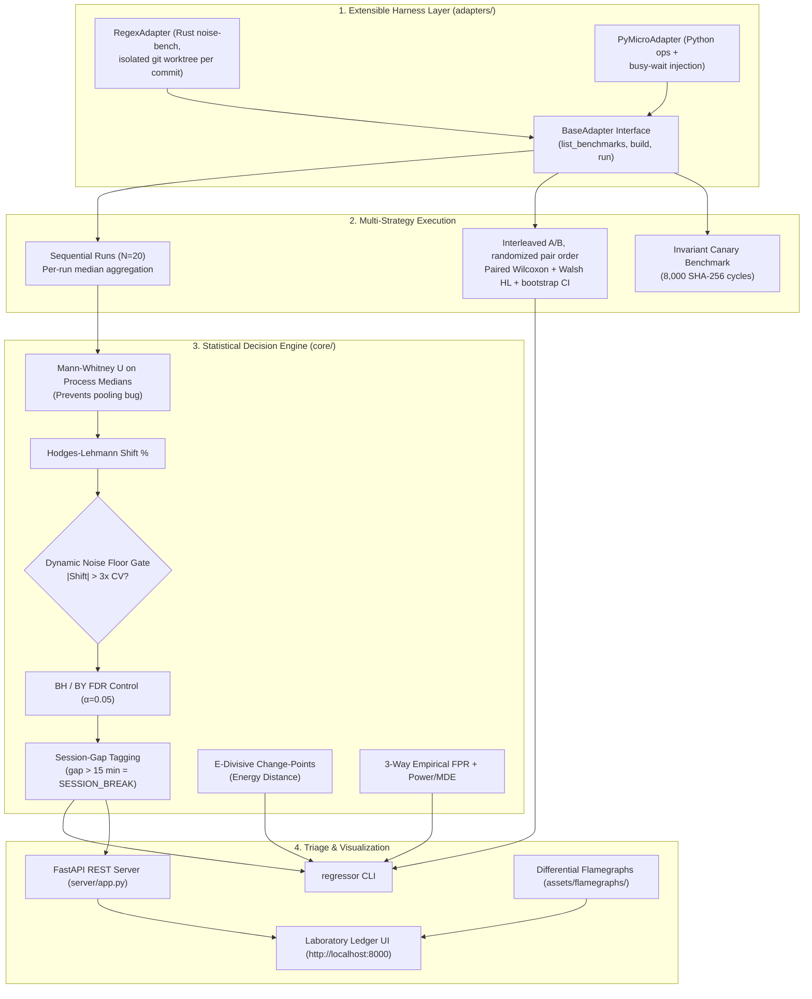

# regressor: Generalized Continuous Performance Regression Framework

[](https://github.com/SeeThisDiva/regressor/actions/workflows/tests.yml)
[](PROJECT_EXPLANATION.md)
[](adapters/)
[](LICENSE)

**A project-agnostic, statistically rigorous framework for catching real performance regressions in noisy cloud CI.**

Shared VMs and CI runners suffer from **12% to 37%** timing variance across hours due to CPU frequency scaling, co-tenant contention, and host migrations—turning naive fixed thresholds (e.g., `>5% slower`) into constant false alarms. `regressor` combines process-level rank statistics, dynamic $3\times\text{CV}$ noise-floor gating, BH/BY FDR control, interleaved A/B execution, session-gap tagging, an invariant SHA-256 canary, and E-Divisive change-point detection.

---

## 30-Second Quickstart

Explore the bundled `rust-lang/regex` dataset and live dashboard locally with **Python 3.11+ only** (no Rust toolchain or Docker required):

```bash
pip install -e ".[dev]"
python regressor.py init
python regressor.py import-data data/regex_history.json.gz
python regressor.py batch regex --verify-legacy
python regressor.py serve --port 8000
```

Open **`http://localhost:8000`** to inspect the time-series ledger, run histograms, session breaks, and differential flamegraphs. For native Rust benchmarking (`RegexAdapter`), Docker sandboxing, or bare-metal Linux CPU isolation, see [`SETUP.md`](SETUP.md).

---

## Study Results (`rust-lang/regex`)

| Study / Environment | Span & Scope | Comparisons | Sequential Flags | Confirmed | Sub-threshold Candidate | Status |
|---|---|---|---:|---:|---|---|
| **Study 1 (Cloud Sandbox 1-vCPU VM)** | 27 commits (`14 Aug 2025` – `27 Jan 2026`), picked from 62 commits touching `src/`, `regex-automata/src/`, or `regex-syntax/src/` | 78 (26 adjacent pairs × 3 benches) | 5 (5/5 false positives) | **0** | **1** (`8f5d947` on `find_iter_userid`, $+2.95\%$ sequential / $+4.10\%$ interleaved; under investigation in Study 1) | Triaged (5/5 FP) |
| **Local Hardware Verification (`8f5d947` + Ablation)** | Intel Alder Lake (Windows 11, High Priority; `find_iter_userid` CV **1.03%** vs 10.54% sandbox) + LTO x86_64 assembly & `_rdtsc` | 50-rep baseline + 3×30 interleaved pairs (`977feeb`, `8f5d947`, `8f5d947-ablation`) | — | **0** | `8f5d947-ablation vs 8f5d947`: **`+0.08%`** time / **`+0.06%`** TSC ($p=0.804$, `ok`); `977feeb vs 8f5d947-ablation` (`+0` insns): **`+3.27%`** LTO layout shift | **Resolved (`ok`, layout artifact)** |
| **Study 2 (Upstream Extension `4733e28..3d79fe9`)** | 24 commits (`4733e28` anchor + 23 new source-touching commits through 7 Nov 2026) | 69 (23 adjacent pairs × 3 benches; 0 session breaks) | 4 (3 refuted by interleaved A/B; 1 cross-crate layout shift) | **0** | 0 (`0/3` doc-only null transitions flagged) | **Complete (0 regressions)** |

### Key Triage Outcomes (0 Upstream Issues Filed)

- **`16d47c5` (`find_iter_userid`, `+1.45%`)**: Doc-only commit (`LazyLock` example); zero compiled code changed. Background cache noise.
- **`0a446ec` (`compile_moderate`, `+12.13%`)**: Clippy lint cleanup. Re-profiling with `perf record -e cpu-clock` showed only `+0.3%` CPU sample delta ([`flamegraph_diff.svg`](assets/flamegraphs/flamegraph_diff.svg)), and 30-pair `compare-interleaved` gave `+0.36%` ($\text{CI}_{95}[-0.64\%, +1.12\%]$, $p=0.440$, `ok`).
- **`dd96592` (All 3 benchmarks, `-12.85%` to `-25.73%`)**: Doc-only commit executed after a **201 min** (3h21m) wall-clock gap on an unpinned shared VM (`SESSION_BREAK`).
- **`8f5d947` (`find_iter_userid`, `+2.95%` sequential, `+4.10%` interleaved — under investigation in Study 1, resolved via ablation)**: Same-hash ablation (`8f5d947-ablation` vs `8f5d947`) isolated `captures_disabled()` at **`+0.08%`** wall-clock ($p=0.804$, `ok`), while `977feeb` vs `8f5d947-ablation` (`+0` executed instructions) shifted **`+3.27%`** due to `rustc` `#[doc]` crate-hash LTO binary-layout reordering ([`flamegraph_diff_8f5d947.svg`](assets/flamegraphs/flamegraph_diff_8f5d947.svg)).

Full forensic write-up, instruction counts, and Study 2 details: [`noise-bench/REPORT.md`](noise-bench/REPORT.md). Hardest engineering bugs fixed: [`BUILD_LOG.md`](BUILD_LOG.md).

---

## Where This Breaks

- **Three single-threaded microbenchmarks**: `compile_moderate`, `find_iter_userid`, and `is_match_status` cover only three specific single-threaded paths. Regressions elsewhere in `regex` (such as `captures_iter` or multi-threaded cache-pool contention) are outside their scope.
- **Adjacent-commit negative dependence**: Commit $C_i$ is the candidate in $(C_{i-1}, C_i)$ and the baseline in $(C_i, C_{i+1})$, so a noisy $C_i$ pushes consecutive shifts in opposite directions. Pass `batch --fdr by` for Benjamini-Yekutieli FDR control under arbitrary dependence, or run `changepoint`.
- **Unpinned sandbox noise**: Study 1 ran on a shared 1-vCPU VM (1.38%–10.54% baseline CV and a 201 min session break), producing 5/5 false positives in sequential batch mode and masking sub-5% effects under the $3\times\text{CV}$ gate.
- **Binary-layout luck in LTO builds**: `rustc` hashes `#[doc]` attributes into crate symbol disambiguators during LTO, causing `+0`-instruction changes to shift hot loops by 2.5%–3.3% (`0a446ec` `find_iter_userid`, `8f5d947-ablation`, `c4865a0`). Separating real extra work from layout effects requires interleaved builds plus assembly or instruction-level ablation.

---

## Architecture & Key Innovations



- **Interleaved A/B (`compare-interleaved`)**: Builds `--base` and `--cand` in isolated worktrees and alternates pairs in randomized `AB`/`BA` order (reporting `order_effect_pct`). Uses the paired **Wilcoxon signed-rank test**, **Walsh Hodges-Lehmann** effect size with 2,000-resample 95% bootstrap CI, `--require-ci-bound` gating, upfront power checks, `(floor)` markers when all non-zero pairs agree ($p = 2/2^N$), and `--no-fail-on-env-suspect` for CI gates.
- **Process-Level Independence & Dynamic $3\times\text{CV}$ Gate**: Summarizes each process invocation to one median before running Mann-Whitney U (avoiding the $p < 10^{-20}$ pooled-iterations fallacy) and scales sensitivity using sample standard deviation (`ddof=1`, Bessel's correction).
- **Session-Break Tagging & Series Change-Points (`batch`, `changepoint`)**: Flags wall-clock gaps $> 15$ min (`[SESSION_BREAK: 201 min gap ...]`) in both CLI output and the UI timeline; complements pairwise tests with $O(n^2)$ E-Divisive permutation testing (`4.3%` FPR on pure noise) and rolling-window baselines (`--rolling-window K`).
- **Three-Way FPR & Power Calibration (`evaluate-power`)**: Reports empirical FPR separately across (1) random within-session splits, (2) contiguous half-session splits, and (3) real doc-only null transitions split by session break, alongside MDE curves.
- **Invariant Canary & Honest Adapters (`core/canary.py`, `adapters/`)**: Samples an 8,000-cycle SHA-256 loop before and after `compare-interleaved` (`warmup=2`, $\max(\min(2\times\text{CV}_{\text{MAD}}, 5.0\%), 2.5\%)$) to catch host drift. Neither adapter falls back silently, and `pmu_status` is recorded honestly as `UNAVAILABLE` when `perf_event_open` is unsupported.

Mathematical derivations and ecosystem comparisons (`benchstat`, `rustc-perf`, `Hunter`, `Perfherder`, `asv`) live in [`PROJECT_EXPLANATION.md`](PROJECT_EXPLANATION.md).

---

## Repository Layout

```text
regressor.py           CLI entrypoint (init, batch, compare-interleaved, bisect, serve, ...)
core/                  Statistical engine, SQLite persistence, canary, power/FPR, PR reports
adapters/              BaseAdapter contract, RegexAdapter (Rust), PyMicroAdapter (Python)
server/, ui/           FastAPI backend and laboratory-ledger dashboard (vendored Chart.js)
projects/              Project manifests (regex.toml) and human triage logs (regex.triage.json)
data/                  Portable gzipped datasets (Study 1 & Study 2)
noise-bench/           Rust timing harness, raw Study 1 commits, analysis scripts, REPORT.md
assets/flamegraphs/    Differential SVG flamegraphs (0a446ec, 8f5d947)
tests/                 Unit, statistical, API, security, and doc/CLI verification suite
scripts/verify.sh      End-to-end verification script (tests, ruff lint, Study 1 reproduction)
examples/              Sample GitHub Actions PR workflow (perf-check.yml)
Dockerfile, action.yml Containerized Rust harness and composite GitHub Action
```

---

## CLI Cheat Sheet

```bash
# Validate an adapter with the 3-point synthetic injection & canary check
python regressor.py validate-adapter PyMicroAdapter --reps 20
python regressor.py validate-adapter RegexAdapter --reps 20

# Interleaved A/B comparison (randomized pair order, paired Wilcoxon + markdown PR report)
python regressor.py compare-interleaved --adapter PyMicroAdapter --base v1 --cand v2 --pairs 20 --inject-ns 500
python regressor.py compare-interleaved --adapter RegexAdapter --repo regex --base 16d47c5 --cand 0a446ec \
    --markdown pr-comment.md --fail-on-regression

# Batch analysis with Benjamini-Yekutieli FDR control under negative dependence
python regressor.py batch regex --fdr by

# Three-way empirical FPR & statistical power / MDE curves
python regressor.py evaluate-power regex --benchmark compile_moderate

# Series-level E-Divisive change-point detection & ad-hoc commit comparison
python regressor.py changepoint regex --benchmark compile_moderate
python regressor.py analyze regex 16d47c5 0a446ec

# Automated statistical bisection with interleaved probes
python regressor.py bisect --demo
python regressor.py bisect --adapter RegexAdapter --repo regex --good cf00423 --bad 0a446ec

# Export / repair SQLite snapshots
python regressor.py export-data regex --out regex_backup.json.gz
python regressor.py dedupe
```

To run `regressor` as a PR check in GitHub Actions, see [`action.yml`](action.yml) and [`examples/perf-check.yml`](examples/perf-check.yml).

---

## Documentation

| Document | Focus |
|---|---|
| [`SETUP.md`](SETUP.md) | Local Python install, Docker container setup, bare-metal Linux CPU isolation, PMU notes |
| [`PROJECT_EXPLANATION.md`](PROJECT_EXPLANATION.md) | Statistical methodology, prior-art comparison, architecture, SQLite schema, power tables |
| [`noise-bench/REPORT.md`](noise-bench/REPORT.md) | Full Study 1 & Study 2 report, triage breakdown, `8f5d947` LTO assembly & ablation |
| [`BUILD_LOG.md`](BUILD_LOG.md) | Engineering postmortems of the hardest bugs fixed while building `regressor` |
| [`CONTRIBUTING.md`](CONTRIBUTING.md) | Contributor setup, verification checks, and adding new `BaseAdapter` targets |

---

## Verification & Testing

Run the full test suite, linter, and end-to-end Study 1 reproduction check:

```bash
pytest -p no:cacheprovider
ruff check .
sh scripts/verify.sh
```

| Verification Check | Verified Behavior | Source |
|---|---|---|
| Study 1 portable reproduction | 27 commits, 78 comparisons, 5 flags (`--verify-legacy`) | [`tests/test_stage2_data.py`](tests/test_stage2_data.py) |
| E-Divisive pure-noise calibration | 4.3% empirical FPR at nominal 5% (fixed from 37.3%) | [`tests/test_stage1_stats.py`](tests/test_stage1_stats.py) |
| Canary MAD spread & 5% cap | Flags 10%–20% host drift despite cold-start outliers | [`tests/test_stage1_stats.py`](tests/test_stage1_stats.py) |
| `/series` bulk query efficiency | $\le 8$ SQLite connections per `/series` request | [`tests/test_stage2_data.py`](tests/test_stage2_data.py) |
| `8f5d947` assembly ablation & Study 2 | `8f5d947-ablation -> 8f5d947` `+0.08%` (`ok`); Study 2 `0` regressions | [`noise-bench/REPORT.md`](noise-bench/REPORT.md) |
| Bare-metal Linux `isolcpus` & Docker build | **Not run on this Windows host**; workflow documented for Linux | [`SETUP.md`](SETUP.md) |

---

## License

MIT License. See [`LICENSE`](LICENSE).
