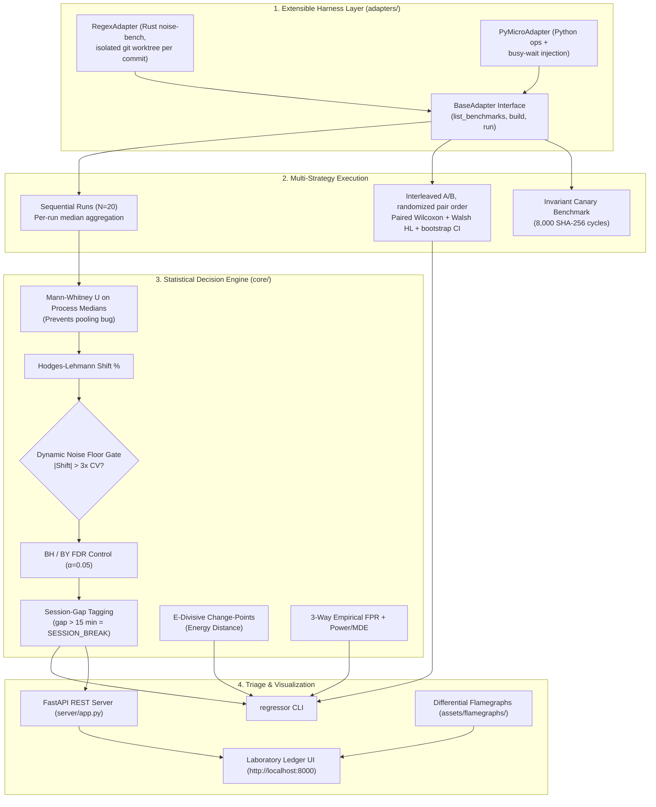

# regressor: Generalized Continuous Performance Regression Framework

[](https://github.com/SeeThisDiva/regressor/actions/workflows/tests.yml)
[](PROJECT_EXPLANATION.md)
[](adapters/)
[](LICENSE)

**A project-agnostic, statistically rigorous framework for catching real performance regressions in noisy cloud CI.**

> **Publishable `rust-lang/regex` Results (Study 3 - 1-Year Master Window `4733e28^..3d79fe9`, 25 `rebar`-Derived Benchmarks):**
> **51** commits analyzed (**1,250** comparisons) · **371** BY-FDR flags · **1** confirmed performance cost of an intentional correctness fix (documented upstream) (**`+94.69%`** pinned interleaved / **`+94.77%`** standalone repro on `rebar_curated_06_cloudflare_redos_long` at [`64ad0b6`](reports/upstream/64ad0b6/ISSUE.md)) · **328** false positives (**88.4%** FP rate, 95% Wilson CI `[84.75%, 91.28%]`) + **42** LTO layout artifacts (**0** unreviewed) · **1** upstream report **drafted, not filed** ([`reports/upstream/64ad0b6/ISSUE.md`](reports/upstream/64ad0b6/ISSUE.md)).
> *(Studies 1 & 2 across 3 legacy microbenchmarks: **0** confirmed, **5/5** & **4/4** false positives, **0** upstream issues filed.)*

Shared VMs and CI runners suffer from **12% to 37%** timing variance across hours due to CPU frequency scaling, co-tenant contention, and host migrations—turning naive fixed thresholds (e.g., `>5% slower`) into constant false alarms. `regressor` combines process-level rank statistics, dynamic $3\times\text{CV}$ noise-floor gating, BH/BY FDR control, interleaved A/B execution, session-gap tagging, an invariant SHA-256 canary, and E-Divisive change-point detection.

---

## 30-Second Quickstart

Explore the bundled `rust-lang/regex` dataset and live dashboard locally with **Python 3.11+ only** (no Rust toolchain or Docker required):

```bash
pip install -e ".[dev]"
python regressor.py init
python regressor.py import-data data/regex_history.json.gz
python regressor.py batch regex --verify-legacy
python regressor.py serve --port 8000
```

Open **`http://localhost:8000`** to inspect the time-series ledger, run histograms, session breaks, and differential flamegraphs. For native Rust benchmarking (`RegexAdapter`), Docker sandboxing, or bare-metal Linux CPU isolation, see [`SETUP.md`](SETUP.md).

---

## Study Results (`rust-lang/regex`)

| Study / Environment | Span & Scope | Comparisons | Sequential Flags | Confirmed | Sub-threshold Candidate | Status |
|---|---|---|---:|---:|---|---|
| **Study 1 (Cloud Sandbox 1-vCPU VM)** | All 27 source-touching commits (`14 Aug 2025` – `27 Jan 2026`; every commit touching `src/`, `regex-automata/src/`, or `regex-syntax/src/` out of 62 commits total in `cf00423^..4733e28`) | 78 (26 adjacent pairs × 3 benches) | 5 (5/5 false positives) | **0** | **1** (`8f5d947` on `find_iter_userid`, $+2.95\%$ sequential / $+4.10\%$ interleaved; under investigation in Study 1) | Triaged (5/5 FP) |
| **Local Hardware Verification (`8f5d947` + Ablation)** | Intel Alder Lake (Windows 11, High Priority; `find_iter_userid` CV **1.03%** vs 10.54% sandbox) + LTO x86_64 assembly & `_rdtsc` | 50-rep baseline + 3×30 interleaved pairs (`977feeb`, `8f5d947`, `8f5d947-ablation`) | — | **0** | `8f5d947-ablation vs 8f5d947`: **`+0.08%`** time / **`+0.06%`** TSC ($p=0.804$, `ok`); `977feeb vs 8f5d947-ablation` (`+0` insns): **`+3.27%`** LTO layout shift | **Resolved (`ok`, layout artifact)** |
| **Study 2 (Upstream Extension `4733e28..3d79fe9`)** | 24 commits (`4733e28` anchor + all 23 source-touching commits out of 50 commits in `4733e28..3d79fe9` through 7 Nov 2026; 3 legacy benches) | 69 (23 adjacent pairs × 3 benches; 0 session breaks) | 4 (3 refuted by interleaved A/B; 1 cross-crate layout shift) | **0** | 0 (`0/3` comment-only `c420333` & `0/3` `docs:` `2c7b172`, `0/6` combined) | **Complete (0 regressions)** |
| **Study 3 (1-Year Window, Pinned P-Core, 25 Benches)** | All **51** commits unfiltered in `4733e28^..3d79fe9` (`27 Jan` – `7 Nov 2026`, continuing Study 1 from the 1-year `5ea3eb1..3d79fe9` window; `24` `src/` + `1` `regex-lite` + `26` non-src; `29` null controls total; `25` `rebar` + legacy benches, `N=15`) | 1,250 (50 pairs × 25 benches; 1 session break `90.6 min` at `72d650c`) | 371 (`328` FP = **88.4%**, 95% Wilson CI `[84.75%, 91.28%]` + `42` LTO layout artifacts; `9` E-Divisive steps) | **1** (`64ad0b6` **`+94.38%`** Study 3 / **`+94.69%`** interleaved) | `fa91c31 -> 64ad0b6` on `rebar_curated_06_cloudflare_redos_long` falls back from `ReverseInner` to `Core` ([`ISSUE.md`](reports/upstream/64ad0b6/ISSUE.md)); `c21ed55` improved `compile_moderate` `-2.98%` interleaved | **Complete (1 issue drafted, not filed; `0` unreviewed)** |

### Key Triage Outcomes (`1` Drafted Upstream Report, Not Filed; Studies 1-2: `0` Issues Filed)

- **`64ad0b6` (`rebar_curated_06_cloudflare_redos_long`, `+94.38%` Study 3 / `+94.69%` pinned interleaved, confirmed performance cost of an intentional correctness fix (documented upstream))**: Commit [`64ad0b6`](reports/upstream/64ad0b6/ISSUE.md) (*"automata: fix bug in reverse suffix/inner optimization"*, `#1354`) caused `ReverseInner::new` -> `has_no_earlier_match` to conservatively reject `.*.*=.*` and fall back to `Core` (`find_fwd` + `find_rev`), nearly doubling match runtime (`64,000 -> 124,600 ns` batched `2x`, $p=1.01\times 10^{-7}$, $\text{CI}_{95}[+94.69\%, +94.69\%]$, persisting through `3d79fe9` at `canary -2.66% OK`). Confirmed by Windows user-mode sampling ([`flamegraph_diff_64ad0b6.svg`](assets/flamegraphs/flamegraph_diff_64ad0b6.svg)), static instruction diff (`+1,242` insns in [`asm_diff_64ad0b6.json`](noise-bench/profiles/asm_diff_64ad0b6.json)), and standalone two-revision Cargo repro (`+94.77%`, $\text{CI}_{95}[+94.69\%, +94.85\%]$, [`reports/upstream/64ad0b6/repro/`](reports/upstream/64ad0b6/repro/)); report **drafted, not filed** at [`reports/upstream/64ad0b6/ISSUE.md`](reports/upstream/64ad0b6/ISSUE.md).
- **Study 3 Null Controls & LTO Layout Artifacts (`328` FP + `42` layout artifacts)**: Tight pinned sub-1% noise floors (`0.00%–3.08%` median CV) raised `218/725` BY-FDR flags across the `29` null-control commits (including `23/75` on `doc:`/`docs:` commits and `Cargo.toml` crate-version bumps like `0c07fae`, `a3433f6`, `5e195de`, `b028e4f`, `2aaa18d` where LTO symbol hash changes reorder `.text` code); `42` source-touching flags were explained via 30-pair interleaved A/B + [`win_profile.py`](noise-bench/analyze/win_profile.py) as layout shifts (e.g., `c21ed55`, `3d79fe9`).
- **`16d47c5` (`find_iter_userid`, `+1.45%`)**: Doc-only commit (`LazyLock` example); zero compiled code changed. Background cache noise clearing a `0.93%` (`ddof=1`) floor.
- **`0a446ec` (`compile_moderate`, `+12.13%`)**: Clippy lint cleanup. Re-profiling with `perf record -e cpu-clock` showed only `+0.30%` total CPU sample delta (`61.75B` → `61.93B` ns in [`flamegraph_diff.svg`](assets/flamegraphs/flamegraph_diff.svg)), and historical 30-pair `compare-interleaved` gave `+0.36%` ($\text{CI}_{95}[-0.64\%, +1.12\%]$, $p=0.440$, `ok`).
- **`dd96592` (All 3 benchmarks, `-12.85%` to `-25.73%`)**: Doc-only commit executed after a **201 min** (3h21m) wall-clock gap on an unpinned shared VM (`SESSION_BREAK`).
- **`8f5d947` (`find_iter_userid`, `+2.95%` sequential, `+4.10%` interleaved — under investigation in Study 1, resolved via ablation)**: Same-hash ablation (`8f5d947-ablation` vs `8f5d947`) isolated `captures_disabled()` at **`+0.08%`** wall-clock ($p=0.804$, `ok`), while `977feeb` vs `8f5d947-ablation` (`+0` executed instructions per [`ablation_8f5d947_instructions.json`](noise-bench/results/ablation_8f5d947_instructions.json)) shifted **`+3.27%`** due to `rustc` `#[doc]` crate-hash LTO binary-layout reordering ([`flamegraph_diff_8f5d947.svg`](assets/flamegraphs/flamegraph_diff_8f5d947.svg)).

Full forensic write-up, Study 3 25-benchmark tables, instruction counts, and Study 2 details: [`noise-bench/REPORT.md`](noise-bench/REPORT.md). Hardest engineering bugs fixed: [`BUILD_LOG.md`](BUILD_LOG.md).

---

## Where This Breaks

- **Microbenchmark coverage boundary**: Studies 1–2 tested 3 single-threaded paths; Study 3 expands to **25** single-threaded microbenchmarks ([`noise-bench/BENCHMARKS.md`](noise-bench/BENCHMARKS.md): 3 legacy + 22 `rebar`-derived benchmarks across `regex`, `regex-lite`, `bytes::Regex`, and `RegexSet`), which still do not measure multi-threaded regex-pool contention or arbitrary application workloads.
- **Adjacent-commit negative dependence**: Commit $C_i$ is the candidate in $(C_{i-1}, C_i)$ and the baseline in $(C_i, C_{i+1})$, so a noisy $C_i$ pushes consecutive shifts in opposite directions. Pass `batch --fdr by` for Benjamini-Yekutieli FDR control under arbitrary dependence, or run `changepoint`.
- **Sub-1% noise floors vs. LTO crate-hash sensitivity**: Pinning P-core `cpu_id=2` crushed `find_iter_userid` baseline CV to `0.33%` (and all 25 benchmarks' median CVs to `0.00%–3.08%`, with non-compile `rebar` paths at `0.00%–1.34%`), which increases sensitivity to **1%–15%** LTO binary-layout reordering triggered even by `Cargo.toml` version bumps (`0c07fae`, `a3433f6`), `docs:`/`#[doc]` symbol-hash changes (`8f5d947-ablation`, `2c7b172`), and cross-crate edits (`c4865a0`, `3d79fe9`). Separating algorithmic extra work from layout luck requires interleaved A/B plus instruction/DWARF profiling (`win_profile.py`). On unpinned shared VMs (Study 1: 1.38%–10.54% CV), the $3\times\text{CV}$ gate conversely masks sub-5% effects. A post-hoc offline check ([`core/layout_floor.py`](core/layout_floor.py), see [`Calibrated layout floor (post hoc)`](noise-bench/REPORT.md#calibrated-layout-floor-post-hoc)) calibrates per-benchmark `3 * SD` layout floors via disjoint 2-fold splits across Study 3's 29 null-control commits: out-of-fold null FPR drops from `217/725` (`29.93%`) to `12/725` (`1.66%`, Wilson 95% CI `[0.95%, 2.87%]`), total alerts drop by >90% (`267 -> 24` and `256 -> 18`), and `64ad0b6` remains flagged in both folds, at the cost of reduced `+8%` single-build injection detection (`24/25 -> 14/25` and `11/25`).
- **Unprivileged hardware PMU / ETW limits**: Cloud VMs lack `perf_event_open` vPMUs, and Windows ETW profiling (`blondie`/`samply`) fails without Administrator elevation; [`noise-bench/analyze/win_profile.py`](noise-bench/analyze/win_profile.py) provides elevation-free Win32 `SuspendThread` + `.pdata`/DWARF sampling and `llvm-objdump` static disassembly attribution, while adapters record `pmu_status: "UNAVAILABLE"`.

---

## Architecture & Key Innovations



- **Interleaved A/B (`compare-interleaved`)**: Builds `--base` and `--cand` in isolated worktrees and alternates pairs in randomized `AB`/`BA` order (reporting `order_effect_pct`). Uses the paired **Wilcoxon signed-rank test**, **Walsh Hodges-Lehmann** effect size with 2,000-resample 95% bootstrap CI, `--require-ci-bound` gating, upfront power checks, `(floor)` markers when all non-zero pairs agree ($p = 2/2^N$), and `--no-fail-on-env-suspect` for CI gates.
- **Process-Level Independence & Dynamic $3\times\text{CV}$ Gate**: Summarizes each process invocation to one median before running Mann-Whitney U (avoiding the $p < 10^{-20}$ pooled-iterations fallacy) and scales sensitivity using sample standard deviation (`ddof=1`, Bessel's correction).
- **Session-Break Tagging & Series Change-Points (`batch`, `changepoint`)**: Flags wall-clock gaps $> 15$ min (`[SESSION_BREAK: 201 min gap ...]`) in both CLI output and the UI timeline; complements pairwise tests with $O(n^2)$ E-Divisive permutation testing (`4.3%` FPR on pure noise) and rolling-window baselines (`--rolling-window K`).
- **Three-Way FPR & Power Calibration (`evaluate-power`)**: Reports empirical FPR separately across (1) random within-session splits, (2) contiguous half-session splits, and (3) real doc-only null transitions split by session break, alongside MDE curves.
- **Invariant Canary & Honest Adapters (`core/canary.py`, `adapters/`)**: Samples an 8,000-cycle SHA-256 loop before and after `compare-interleaved` (`warmup=2`, $\max(\min(2\times\text{CV}_{\text{MAD}}, 5.0\%), 2.5\%)$) to catch host drift. Neither adapter falls back silently, and `pmu_status` is recorded honestly as `UNAVAILABLE` when `perf_event_open` is unsupported.

Mathematical derivations and ecosystem comparisons (`benchstat`, `rustc-perf`, `Hunter`, `Perfherder`, `asv`) live in [`PROJECT_EXPLANATION.md`](PROJECT_EXPLANATION.md).

---

## Requirements Traceability

Mapping each build-order requirement (and the publishable summary metric) to where it is satisfied in the repository:

| Build-Order Requirement | Where Satisfied in Repository | Verification / Status |
|---|---|---|
| **1. Profile every commit** | [`noise-bench/src/main.rs`](noise-bench/src/main.rs) (25 benchmarks: 3 legacy + 22 `rebar`-derived in [`noise-bench/BENCHMARKS.md`](noise-bench/BENCHMARKS.md)), [`adapters/regex_adapter.py`](adapters/regex_adapter.py), [`projects/regex.toml`](projects/regex.toml), [`noise-bench/harness/run_study3.py`](noise-bench/harness/run_study3.py), [`scripts/continuous_collect.py`](scripts/continuous_collect.py) | Verified across Study 1 (`27`), Study 2 (`24`), and Study 3 (`51` commits × `25` benches × `15` reps = `19,125` runs, `0` build failures) + [`tests/test_benchsuite.py`](tests/test_benchsuite.py). |
| **2. Statistical change detection** | [`core/detector.py`](core/detector.py) (process-median Mann-Whitney U, Hodges-Lehmann, $3\times\text{CV}$ `ddof=1` gate, BH/BY FDR, AR(1) block bootstrap), [`core/interleaved.py`](core/interleaved.py), [`core/series_detector.py`](core/series_detector.py), [`core/canary.py`](core/canary.py), [`core/session.py`](core/session.py), [`core/validation.py`](core/validation.py), [`core/power.py`](core/power.py) | Verified by `test_stats.py`, `test_stage1_stats.py`, `test_new_methods.py`, `test_review_fixes.py`, and `test_validation_gate.py`. The Study 3 50-rep baseline random A/A result (`0/25,000` FPR) is recorded in [`noise-bench/results/study3_analysis.json`](noise-bench/results/study3_analysis.json); raw per-iteration baseline samples were not retained so it cannot be recomputed from the repo. |
| **3. Run over a year of history** | [`data/regex_history.json.gz`](data/regex_history.json.gz) (`14 Aug 2025` – `27 Jan 2026`), [`data/regex_study2_history.json.gz`](data/regex_study2_history.json.gz) (`4733e28..3d79fe9`, 3 legacy), [`data/regex_study3_history.json.gz`](data/regex_study3_history.json.gz) (all `51` commits in `4733e28^..3d79fe9` through `7 Nov 2026`, `25` benches) | Combined Studies 1 + 3 span **Aug 2025 – Nov 2026** (covering the 1-year `5ea3eb1..3d79fe9` window after Study 1 with zero commit filtering, `0` build failures). |
| **4. Confirm / explain flags** | `regressor.py compare-interleaved`, [`noise-bench/analyze/triage_interleaved.py`](noise-bench/analyze/triage_interleaved.py), [`noise-bench/analyze/win_profile.py`](noise-bench/analyze/win_profile.py), [`core/bisect.py`](core/bisect.py), [`projects/regex.triage.json`](projects/regex.triage.json), [`noise-bench/REPORT.md`](noise-bench/REPORT.md) | All `5` Study 1, all `4` Study 2, and all `371` Study 3 BY-FDR flags reviewed (`379` entries, `0` unreviewed): `1` confirmed (`64ad0b6`), `42` LTO layout artifacts, `336` FPs (`328` in Study 3). |
| **5. Upstream report with flamegraph + repro** | [`reports/upstream/64ad0b6/ISSUE.md`](reports/upstream/64ad0b6/ISSUE.md), standalone Cargo repro [`reports/upstream/64ad0b6/repro/`](reports/upstream/64ad0b6/repro/), [`reports/upstream/repro-template/`](reports/upstream/repro-template/), [`assets/flamegraphs/flamegraph_diff_64ad0b6.svg`](assets/flamegraphs/flamegraph_diff_64ad0b6.svg), [`assets/flamegraphs/flamegraph_diff_64ad0b6_insn.svg`](assets/flamegraphs/flamegraph_diff_64ad0b6_insn.svg), [`noise-bench/analyze/flamegraph.py`](noise-bench/analyze/flamegraph.py) | Standalone repro verified `+94.77%` (`CI95 [+94.69%, +94.85%]`); XML-valid SVGs verified; issue **drafted, not filed** (Studies 1–2: 0 issues because 0 confirmed). |
| **6. Dashboard per benchmark** | [`server/app.py`](server/app.py), [`ui/index.html`](ui/index.html), [`core/report.py`](core/report.py), `regressor.py summary`, `regressor.py export-site` | Scaled to 25 benchmarks with study switcher (`study1`–`study3`), search & triage-status filters, Wilson-CI summary panel, flamegraph drawer, and static bundle export ([`tests/test_summary_reporting.py`](tests/test_summary_reporting.py), [`tests/test_dashboard_scaling.py`](tests/test_dashboard_scaling.py)). |
| **7. Containerized (+ CI)** | [`Dockerfile`](Dockerfile), [`docker-compose.yml`](docker-compose.yml), [`scripts/container_entrypoint.sh`](scripts/container_entrypoint.sh), [`scripts/run_in_container.sh`](scripts/run_in_container.sh), [`scripts/pin_host.sh`](scripts/pin_host.sh), [`.github/workflows/tests.yml`](.github/workflows/tests.yml), [`.github/workflows/container.yml`](.github/workflows/container.yml), [`.github/workflows/continuous.yml`](.github/workflows/continuous.yml), [`action.yml`](action.yml) | Static, dry-run, and unit-test validated in [`tests/test_platform_ci.py`](tests/test_platform_ci.py) (`tests.yml` runs on Linux/Windows CI; Docker builds, `container.yml`, `continuous.yml`, and live `pin_host.sh --apply` **not run on this Windows host**). |
| **Number to publish** | [`core/report.py`](core/report.py), `python regressor.py summary regex --study study3`, [Study Results](#study-results-rust-langregex), [`noise-bench/REPORT.md`](noise-bench/REPORT.md) | **Study 3**: `51` commits, `25` benches, `1,250` comparisons, `371` flags, `1` confirmed, `328` FP (**88.4%**, Wilson 95% CI `[84.75%, 91.28%]`), `42` layout artifacts, `0` unreviewed, `1` upstream report drafted, not filed. |

---

## Repository Layout

```text
regressor.py           CLI entrypoint (init, batch, compare-interleaved, bisect, summary, export-site, serve)
core/                  Statistical engine, SQLite persistence, canary, power/FPR, PR & summary reports
adapters/              BaseAdapter contract, RegexAdapter (Rust), PyMicroAdapter (Python)
server/, ui/           FastAPI backend and 25-benchmark laboratory-ledger UI (vendored Chart.js, static export)
projects/              Project manifests (regex.toml) and human triage logs (regex.triage.json, 379 entries)
data/                  Portable gzipped datasets (Study 1, Study 2, Study 3 51-commit × 25-bench)
noise-bench/           Rust timing harness (25 benches), BENCHMARKS.md, Study 1 raw runs, Study 1-3 analysis JSONs & profiles, win_profile.py, REPORT.md
assets/flamegraphs/    Differential SVG flamegraphs (0a446ec, 8f5d947, 64ad0b6 sample & insn)
reports/upstream/      Draft upstream report + standalone 2-rev Cargo repro (64ad0b6/) and repro-template/
tests/                 Unit, statistical, benchsuite, platform/CI, dashboard, summary, security, and doc/CLI tests
scripts/               verify.sh, container_entrypoint.sh, run_in_container.sh, pin_host.sh, continuous_collect.py
examples/              Sample GitHub Actions PR workflow (perf-check.yml)
Dockerfile, compose    Containerized offline-capable Rust harness (docker-compose.yml) and GitHub Action (action.yml)
```

---

## CLI Cheat Sheet

```bash
# Validate an adapter with the 3-point synthetic injection & canary check
python regressor.py validate-adapter PyMicroAdapter --reps 20
python regressor.py validate-adapter RegexAdapter --reps 20

# Interleaved A/B comparison (randomized pair order, paired Wilcoxon + markdown PR report)
python regressor.py compare-interleaved --adapter PyMicroAdapter --base v1 --cand v2 --pairs 20 --inject-ns 500
python regressor.py compare-interleaved --adapter RegexAdapter --repo regex --base 16d47c5 --cand 0a446ec \
    --markdown pr-comment.md --fail-on-regression

# Batch analysis with Benjamini-Yekutieli FDR control under negative dependence
python regressor.py batch regex --fdr by

# Three-way empirical FPR & statistical power / MDE curves
python regressor.py evaluate-power regex --benchmark compile_moderate

# Series-level E-Divisive change-point detection & ad-hoc commit comparison
python regressor.py changepoint regex --benchmark compile_moderate
python regressor.py analyze regex 16d47c5 0a446ec

# Automated statistical bisection with interleaved probes
python regressor.py bisect --demo
python regressor.py bisect --adapter RegexAdapter --repo regex --good cf00423 --bad 0a446ec

# Publishable study summary (Wilson 95% CI, triage overlay) & static dashboard export
python regressor.py summary regex --study study3
python regressor.py export-site ./site

# Export / repair SQLite snapshots
python regressor.py export-data regex --out regex_backup.json.gz
python regressor.py dedupe
```

To run `regressor` as a PR check in GitHub Actions, see [`action.yml`](action.yml), [`examples/perf-check.yml`](examples/perf-check.yml), [`.github/workflows/container.yml`](.github/workflows/container.yml), and [`.github/workflows/continuous.yml`](.github/workflows/continuous.yml).

---

## Documentation

| Document | Focus |
|---|---|
| [`SETUP.md`](SETUP.md) | Local Python install, Docker/Compose container setup, CI workflows, Linux CPU isolation, Windows profiling |
| [`PROJECT_EXPLANATION.md`](PROJECT_EXPLANATION.md) | Statistical methodology, prior-art comparison, 25-bench suite, UI/summary scaling, SQLite schema |
| [`noise-bench/REPORT.md`](noise-bench/REPORT.md) | Full Study 1, Study 2 & Study 3 reports, `64ad0b6` upstream finding, `8f5d947` ablation |
| [`noise-bench/BENCHMARKS.md`](noise-bench/BENCHMARKS.md) | Inventory & baseline CVs for all 25 benchmarks (3 legacy + 22 `rebar`-derived) |
| [`BUILD_LOG.md`](BUILD_LOG.md) | Engineering postmortems of the hardest bugs fixed while building `regressor` |
| [`CONTRIBUTING.md`](CONTRIBUTING.md) | Contributor setup, verification checks, upstream repro template, adding `BaseAdapter` targets |

---

## Verification & Testing

Run the full test suite, linter, and end-to-end Study 1 reproduction check:

```bash
pytest -p no:cacheprovider
ruff check .
sh scripts/verify.sh
```

| Verification Check | Verified Behavior | Source |
|---|---|---|
| Study 1 & Study 3 portable datasets | Study 1 (`27` commits, `78` comparisons, `5` flags `--verify-legacy`); Study 3 (`51` commits, `25` benches, `1,250` comparisons, `371` flags, `1` confirmed, `0` unreviewed) | [`tests/test_stage2_data.py`](tests/test_stage2_data.py), [`tests/test_summary_reporting.py`](tests/test_summary_reporting.py) |
| Standalone `64ad0b6` upstream repro | Two-revision Cargo A/B (`fa91c31` vs `64ad0b6`): `+94.77%` (`CI95 [+94.69%, +94.85%]`); XML-valid SVG flamegraphs | [`reports/upstream/64ad0b6/ISSUE.md`](reports/upstream/64ad0b6/ISSUE.md) |
| E-Divisive pure-noise calibration | 4.3% empirical FPR at nominal 5% (fixed from 37.3%); Study 3 baseline random A/A `0/25,000` (`0.00%`) recorded in `noise-bench/results/study3_analysis.json` (raw baseline samples were not retained and cannot be recomputed from the repo) | [`tests/test_stage1_stats.py`](tests/test_stage1_stats.py), [`noise-bench/REPORT.md`](noise-bench/REPORT.md) |
| Canary MAD spread & 5% cap | Flags 10%–20% host drift despite cold-start outliers | [`tests/test_stage1_stats.py`](tests/test_stage1_stats.py) |
| Dashboard 25-bench scaling & `/series` | $\le 8$ SQLite connections per `/series` request; study switching & static export | [`tests/test_stage2_data.py`](tests/test_stage2_data.py), [`tests/test_dashboard_scaling.py`](tests/test_dashboard_scaling.py) |
| `8f5d947` assembly ablation & Study 2 | `8f5d947-ablation -> 8f5d947` `+0.08%` (`ok`); Study 2 `0` regressions | [`noise-bench/REPORT.md`](noise-bench/REPORT.md) |
| Bare-metal Linux `isolcpus`, Docker & CI workflows | Statically/dry-run validated in `tests/test_platform_ci.py`; **actual Docker builds, `container.yml`/`continuous.yml`, and `pin_host.sh --apply` were not run on this Windows host** | [`SETUP.md`](SETUP.md) |

---

## License

MIT License. See [`LICENSE`](LICENSE).
